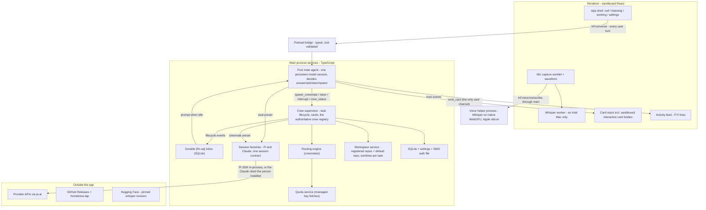

# Infinitary - Architecture

Status: **decided** (captain sign-off 2026-08-13; the decision record is §14).
Implementation boundaries are in §17.

Product vision, interaction rules, and all visual/brand law live in the project skill `.claude/skills/infinitary-design/` (see its `readme.md`).

The agent runtime and provider/auth layer is **Pi** (`@earendil-works/pi-coding-agent`).
Releases are **properly signed and notarized**, never ad-hoc signed (captain-directed; §10).

## 1. Constraints (fixed by the captain)

- Production-quality **Electron** desktop app.
- **Local-only.**
  No SaaS, no hosted backend, no account system of ours.
  The one service of ours the person's work passes through is the card-push relay, sealed (captain-approved 2026-11-17, INF-4774's direction A): reached only for a paired phone that asked for pushes, it forwards cards sealed so only that phone can read them (`docs/phone-push.md`).
  Outbound network is limited to: first-party provider APIs (via Pi, including quota/usage endpoints using Infinitary-managed keys), Pi's model catalog at `pi.dev` (unauthenticated `GET /api/models/providers/<id>`, ETag-revalidated, ~4h cache - captain-approved 2026-08-17, and for Anthropic and OpenAI also while a custom connection is set up or saved - captain-approved 2026-11-17, see §16.3), each signed-in Codex or Grok account's own model list (`chatgpt.com/backend-api/codex/models`, `api.x.ai/v1/models`, with that account's credential exactly as its quota read sends it - `docs/model-lists.md`), the pinned voice-model download, the public tap's update targets file, builds file and GitHub releases metadata for the update indicator, and on Linux the offered build's download from the tap's release when the person presses Install, a native decision model's endpoint (`api.typesafe.ai/v1/systemone` with the person's TypeSafe key, or `openrouter.ai/api/v1/systemone` through the selected OpenRouter account's Pi runtime), only while the user has turned it on and accepted its approval screen - it carries the facts of the decision model uses listed in `docs/decision-models.md` that are switched on, and nothing reaches it on a default install -, OpenRouter browser sign-in at `openrouter.ai/auth` and its `POST openrouter.ai/api/v1/auth/keys` key exchange, with a local loopback callback listener only while sign-in is underway, the diagnostics endpoint (§12), only while the person has turned the Diagnostics switch on and seen the payload once (`docs/sharing.md`); nothing reaches it on a default install either - and the host a project lives on, only for a project whose changes are offered there (the forge seam, `docs/forge.md`): git's own fetch and push to that project's approved origin and owned contribution fork, and on GitHub its API (`api.github.com`, with the person's in-app GitHub sign-in, listed like the quota endpoints) plus GitHub's device-flow sign-in at `github.com/login/device/code` and `github.com/login/oauth/access_token`, only when the person starts a sign-in in Settings -> Integrations (§16.7, `docs/integrations.md`).
  GitLab discovery, merge-request delivery, a crewmate's pipeline evidence and API calls, and the open-changes read reach `https://<host>/api/v4` on gitlab.com or a self-hosted server the person names, only through the app's own per-host sign-in (`docs/forge.md`, "GitLab sign-in and projects", "GitLab merge requests", "Workflow logs and artifacts", "The gateway"); a job's artifacts archive is then fetched, without the key, from the storage GitLab redirects it to: gitlab.com's artifacts CDN or Google Cloud Storage, or Amazon S3, Azure Blob or Google Cloud Storage for a self-hosted server.
  GitLab browser sign-in reaches `https://<host>/oauth/authorize_device` and `/oauth/token` for a public application the person registers there; it uses the existing browser-and-code flow with no listener or application secret (`docs/forge.md`, "Browser sign-in and renewal").
  Native evidence uploads for future github.com changes additionally reach `https://uploads.github.com/user-attachments/assets` through the task-scoped forge capability and the app's own sign-in, with redirects refused (`docs/forge.md`, "Saved change stories").
  Future gitlab.com merge requests upload theirs to the same `https://gitlab.com/api/v4` with that host's sign-in, as multipart `POST /projects/<id>/uploads`, with redirects refused; a self-hosted server's own host sends none.
  Direct-install updates, Linux updates and paired-computer downloads read the build-owned `downloads.getinfinitary.com` HTTPS feed and immutable release files (`docs/alpha.md`, “Download storage”), with the public tap retained for historical versions and before the download host exists.
  When the person presses Add or Update for a Mac reached by its address, that Mac may download this computer's published version from that download service or the public tap's GitHub release, following HTTPS redirects to its release-asset storage and checking the published SHA-256 and the release publisher's signature before starting the app.
  The same download, with the same checks, is made by a Mac a command added when the person presses Update and it takes the download order, and by the command for another Mac after the person there types yes (`docs/devices.md`, "Downloading over the connection" and "Joining by a command").
  Card pushes reach `push.getinfinitary.com` with a phone's push address, its relay grant and the card sealed under that phone's own key, only while a paired phone has asked for them and the Notifications switch is on (`docs/phone-push.md`).
  No other program's GitHub sign-in is ever read.
  A project kept on this Mac reaches no host.
- **Google, once the person signs in to it** (INF-784, `docs/integrations.md` "Google"): Google's consent page in the person's own browser, with a loopback listener on `127.0.0.1` only while that sign-in is underway; `oauth2.googleapis.com` for the sign-in's code exchange, its renewal and its revocation; and Gmail's API at `gmail.googleapis.com` and Calendar's API at `www.googleapis.com/calendar/v3` with the person's own Google sign-in, for what an agent asks and rules listening for new mail or calendar changes.
  A packaged build reaches none of it until Infinitary has its own Google client.
- **An MCP server the person adds** (INF-781, `docs/integrations.md` "MCP servers"): an address reaches only that server, through the custom API's network classes held from when it was added, with redirects and other origins refused and plain http only on this computer; a program the person names runs as a child on this computer and reaches whatever that program reaches.
- **A task's browser reaches public websites over https, and the private sites the captain listed** (rev-10; `docs/task-browser.md`, "Where a page may go" and "Private sites"): the sites a task needs, chosen by its crewmate's instructions, never by the host.
  Every connection off this Mac's loopback goes through that browser's own connection guard (`src/core/browser/connectionGuard.ts`), which resolves the name itself and connects only to a public address it checked, so a public name that leads to this Mac or a private network is refused at the connection; a name on the captain's private sites list may also reach its private-network answers, over https or http, but never this Mac's loopback, link-local or metadata addresses; other plain http, certificate errors, site sign-in boxes and client certificates are refused too, and nothing falls back to the person's own browser.
  An UNPACKAGED dev checkout may additionally point the first mate seat at a local OpenAI-compatible endpoint the developer names in the environment (`docs/local-orchestrator.md`, roadmap 1.7); a packaged build cannot enable it, by contract test.
- **Usage report destinations** (INF-6587's approved plan, `docs/usage-report.md`): Infinitary's own usage report reaches only the OTLP/HTTP addresses its destinations name - a company's Claude Code reporting setup, or a reporting connection the person adds - from the computer that keeps the ledger, with each destination's own headers, redirects refused, and counts, models, cost estimates, the role, the saved kind of work, tool names and call ids, and in Claude Code's format the email of the person's own Claude Code login, where Claude's records carry it; never words, titles or project names.
  With no destination nothing is sent.
  The person's connection is held to the network class read when it was saved, plain http only on this computer, with its headers applied inside Secrets.
- **Approved custom API destinations (FI3-337).**
  Custom API from Intelligence and first setup is a connection-specific outbound exception for public HTTPS, explicitly approved private/VPN HTTPS and explicit loopback HTTP/HTTPS, only through the guarded transport behind the Pi/account/runtime/session boundaries.
  No redirects, ambient credential/proxy fallback, global trust edits or arbitrary endpoints.
  App-owned isolated credentials, revision-bound synthetic checks and explicit model selection gate every consumer, including compaction/background decisions; Responses defaults to `store:false`, with omission only after connection-specific consent.
  Private HTTPS alone may append approved public PEM CAs to Node bundled normal roots, retaining hostname/chain/expiry verification.
  Pause gates subsequent requests; Disconnect stops matching work without migrating it or deleting siblings/history.
  See `docs/custom-api.md` for the profiles, storage/retention limits and packaged transport evidence.
- **The app brings its own git** (git integration phase 2, `docs/forge.md` "The app's own git"): dugite-native's macOS git for both architectures ships in the bundle (`Contents/Resources/git/`, GPLv2, named in `NOTICE`), every host git runs it, and a crewmate's shell finds it first on its search path.
  It reaches nothing the git egress above does not already name; a Mac with no developer tools needs none.
- **Listeners have explicit scopes.**
  The device-connection listener accepts no connection from another computer until a device is paired with it or a link to pair one is open; then it listens on loopback and at most one chosen private address of this Mac, never a wildcard, speaks only TLS 1.3 pinned to the home's own key, and refuses browsers and unproven devices before any frame (`docs/connection.md`, `docs/devices.md`).
  The local door listens on loopback alone for as long as the app runs, over TLS 1.3 with a key of its own, and admits only a client that read its key from a folder only this account can open (`docs/connection.md`, "The local door").
  A task browser's connection guard also listens: on loopback alone, only while that browser is open, answering only that browser's session, which signs in with a secret made for it, and carrying nothing but its tunnels to public addresses.
  Claude call-cost recording also permits one private loopback receiver per session factory on the computer running work, with an unguessable route per client attachment (`docs/usage.md`, "Claude calls during a turn").
  It accepts only app-scoped cost reports, persists no content or identity data, and stops when its last attachment ends; it grants no general listening permission.
  Its one onward destination is the collector a company's Claude Code setup in the person's own settings file or shell names, which receives the client's own records unchanged, as Claude Code would send them there (`docs/usage.md`, "A company's Claude Code setup").
- **BYO subscriptions.**
  Users authenticate with their own plans.
  We never provide model access and never hold user credentials anywhere but the user's machine.
- Calm, cards-not-chat, first mate character, quota-aware routing - per the design skill.
  (Other Macs and computers join one home Mac over a paired connection, decision D-11 as amended, §9.)

## 2. System overview: the orchestrator loop

**The loop.**
Every user turn goes to the **first mate agent** - one persistent model session (a rolling record under `userData/firstmate/`, resumed across restarts) whose system prompt decides per turn: **answer** (a note card), **ask** (one concise decision card), **steer** (route feedback to a running crewmate), or **spawn** (write a brief and commission a crewmate).
The backend's built-ins stay off structurally (`builtins: "none"` on the seat's spec); every capability is an app-owned typed tool from the one tool spec (`FIRSTMATE_TOOLS`, `src/core/session/tools.ts`): `emit_card`, `close_card`, the crew tools (`spawn_crewmate` with queue gates, `steer_crewmate`, `interrupt_crewmate`, `settle_task`, `crew_status`), the task graph, the schedule tools (`schedule_prompt`, `cancel_schedule`) and typed lookups - no bash and no file reads since contract v2; reading is a crewmate's job (`docs/orchestrator-contract.md`).
Its model is one fixed user-visible setting with a subscription-derived default, never dynamic routing.

**One model session for three roles** (captain-approved design `fm3000-one-session-three-roles-s1`, 2026-09-27; built in eight steps).
Every model session the app opens - the first mate's seat, each crewmate, and the decision model's question - is one backend-neutral `ModelSession`, opened by a `SessionFactory` from a `SessionSpec` (`src/core/session/session.ts`, which imports no backend runtime).
Pi and Claude are its two implementations, each behind its own fence (`src/core/pi/session.ts`, `src/core/claude/session.ts`), and the composition root builds the one pair every role opens on (`sessionFactories` in `src/core/services.ts`).
**The roles are presets, not modes**: a small function beside each role's owner fills the spec - `seatSessionSpec` (`src/core/orchestrator/seat.ts`), `crewmateSessionSpec` (`src/core/orchestrator/crewSession.ts`), `questionSessionSpec` (`src/core/session/questionSession.ts`) - and a factory never sees a role name.
What a role owns stays with it (the seat's account and pause ladder, the crewmate's routing and worktree, the question's walk); what is shared is neutral: the account to binding step (`SessionBinder`, `src/core/session/binding.ts`), admission (`admits`), the runaway time bounds on the host's one clock (`BoundsWatcher`, `src/core/session/bounds.ts`), and the one tool spec (`src/core/session/tools.ts`).
One behavioral suite (`tests/helpers/sessionContract.ts`) runs every role's cases with identical assertions on real Pi, on a scripted Claude client and on the real Claude client boxed against a stub API.
A rolling Pi session's disposal refuses further input, aborts the run and waits for idle and any host-side prompt preparation before disconnecting its transcript writer and resolving `closed()`.
An already-running app callback can return after cancellation; its actual result stays in the saved Pi conversation before closure.
This is a session-lifecycle boundary, not proof that cancelling a native tool or replacing the app is safe.

**The seat seam** (W1 S4, 2026-09-26).
The agent never talks to a backend: it holds one `ModelSession` opened from the seat preset, which opens no session: it fills the spec with the first mate's prompt, contract stamp and bounds, and the backends only persist what they are handed.
`Flagship.resolveBinding` returns a `SeatBinding` (an alias of the one `SessionBinding`) - `{backend: "pi", accountId?, runtime}` or `{backend: "claude", accountId}` - through a `SessionBinder`, and `FirstmateAgent` picks the session factory from `binding.backend` out of its `{pi, claude?}` map; a binding whose backend has no factory fails like any session create, through the existing failure card.
Each backend keeps its own rolling session and resume pointer (`{backend: "pi", sessionFile}` or `{backend: "claude", sessionId}`: the two transcript formats do not carry across), and a purge forgets both.
A purge also removes both transcript directories, `firstmate/sessions/` and `firstmate/claude/`, and a retired `supervision/sessions/` directory if one remains.
A session emits the normalized `FmEvent`s plus the contract's owner-only events (`turn_closed {text?}` carrying a model turn's closing words, `request_started`, `continuation_started`, `continuation_ended`, `model_served` naming the model that answers and the fallback that moved it, if any), which never reach the feed; each backend translates its own events inside its seam, so the agent, decision capture, the kind classifier's adapter and the replay's one fake `SessionFactory` read no backend's event shape.
Since the flip (W1 S12, rev-9) the Claude factory serves the seat too (`docs/claude-client.md`), so a Claude login is as eligible as any account (§16).

**The first mate's turns are steer-only.**
`inf:converse` accepts a turn immediately (the invoke returns before the model finishes).
If the orchestrator is already streaming or running, that user text is always `session.steer` - never abort.
There is no first-mate-turn cancel surface and no `inf:firstmate:abort`.
Crewmate task abort exists (`inf:task:abort` → supervisor cancel; the first mate also has `interrupt_crewmate`).
The captain kept this (2026-08-14 architecture review): the user can redirect a live first mate turn, not stop it.

**Cards are captain-action-only.**
`emit_card` is the agent's only card channel (schema-validated at the tool boundary).
Final assistant text is unused for the UI and is never a feed line or chat.
FYI events - spawns, reports, close-outs, host-raised notes - live in the feed.

**Workspace inference.**
No workspace picker exists.
An explicitly named registered project wins; a clear follow-up inherits its referent; otherwise the first mate matches work against the project scopes last shown and asks when none or more than one fit.
Each ordinary project has optional scope text set in Settings or by talking; the personal workspace takes none.
A separate prominent scope snapshot lists all ordinary projects and "not set" for empty scopes, only after a project or scope changes or after context loss.
Session attachment (including rebound and restart) and a backend-neutral successful-compaction event invalidate the in-process shown snapshot, so the next turn carries scopes again.
The per-turn project index and focus hint do not repeat them, and the host never judges scope fit.

**Context discipline** (context held as a variable rather than replayed, deliberately without an IPython runtime): the context is a compact index (repos, started crew, the backlog's count, quota one-liner) served whole once per conversation and then as changes (`docs/orchestrator-contract.md`, "What a context carries"), and `crew_status`, `tasks` and `open_work` are the query side; the host - the **crew supervisor** plus SQLite - is the authoritative registry, so the agent's transcript stays lossy and compactable without ever losing the fleet.
`spawn_crewmate` follows the admission-handle discipline: it returns the task id immediately and results arrive only as `[fm-op]` messages through the **durable inbox** (delivered when the agent session is idle, surviving app quits; the wake diet, P3/WI-13, holds the first pending wake a short window so a burst drains as one turn, and a captain turn carries the pending wakes with it), and an unknown `repo_id` rejects the spawn loudly instead of silently defaulting.

**Crewmates** are multi-turn model sessions opened from the crewmate preset on the same session factories (only when the agent commissions work): worktree per task, the backend's full coding toolset including bash (`builtins: "coding"`; isolation is social, §4), quota-routed model and account, on Pi or Claude by the account's provider.
A completed turn leaves the task idle and steerable - follow-ups continue the same crewmate; Done on the task card decommissions it.
Each runtime's `CrewTurn` owns one phase for opening, preparing, prompted work, provider continuations, idle or stopped preparation, together with the inbox batch and any requested end or move that phase carries (`docs/inbox.md`, "Preparing a crewmate's first turn").
A local-only finish goes in with `land` (`WorkspaceService.landTaskWork`): a local git merge, fast-forward when possible, a merge commit otherwise, and a conflict refuses with a card.
A direct-pr finish on GitHub goes in with `merge-pr` (`GitHubForge.putIn`), which calls GitHub's merge endpoint (`PUT /repos/{owner}/{repo}/pulls/{n}/merge`, squash); a plain host pushes the checked head to the default branch instead (`PlainGitForge.putIn`).
The session factory is the seam a session placed on another computer opens through, without rearchitecting (decision D-11, §9).

## 3. Stack (decided)

| Layer | Choice |
|---|---|
| Shell | Electron 43.x (Chromium 150, Node 24), pinned minor at implementation start |
| Language / PM | TypeScript strict, ESM · pnpm (`supportedArchitectures` darwin x64+arm64) |
| Build | electron-vite 5 |
| Renderer | React 19 · plain CSS from the design-skill tokens · zustand |
| Agent runtime | `@earendil-works/pi-coding-agent` + `@earendil-works/pi-ai`, pinned minor, in-process in main |
| IPC | contextBridge + typed channel map, zod 4 validated both directions |
| DB | better-sqlite3 (WAL) |
| Voice | `@huggingface/transformers` 4.x, whisper-large-v3-turbo (pinned HF revision) on WebGPU: `onnxruntime-node` in the voice helper process, onnxruntime-web in a window worker on an Intel Mac |
| Quota | in-process first-party usage fetches with Infinitary-managed keys + routing engine |
| Packaging | electron-builder ≥ 26.8.2, macOS universal, and Linux x64 packages (`docs/linux-packages.md`) |
| Signing | Developer ID + hardened runtime + notarization + stapling |
| Releases | `release.yml` from main: an alpha's reviewed candidate, a stable promoting it (bare `v` tags) → verified disk images and update feeds beside generated casks in `infinitary-labs/homebrew-tap` |
| Updates | Per-copy Mac ownership: Homebrew upgrade command for casks, consented native replacement for direct installs; on Linux the same indicator installs a checked deb, rpm or AppImage after the person presses Install |
| Analytics | Umami, build-time host/site-id defines: an allowlisted set of anonymous events (launch, first mate turn end/failure, the first-run funnel) with enum/boolean/number fields, the app version and an anonymous random install ID, behind the Diagnostics switch - on by default, disclosed, opt-out (captain, 2026-09-22, `docs/sharing.md`) |
| Tests | vitest · Playwright for Electron · realSession contract test pinning the `createAgentSession` shape |
| Lint | Biome + the design skill's `_adherence.oxlintrc.json` in CI |

## 4. Process and security model

Non-negotiable baseline (enforced by a startup assertion in dev builds):

- **BrowserWindow**: `contextIsolation: true`, `nodeIntegration: false`, `sandbox: true`, `webSecurity: true`.
  Single app window; no `webview` tag; no remote content in it.
  The one other surface is a task browser's hidden page (below).
- **CSP** via `onHeadersReceived` + meta fallback: `default-src 'none'; script-src 'self' 'wasm-unsafe-eval'; style-src 'self' 'unsafe-inline'; img-src 'self' data: app-frame:; font-src 'self' app-frame:; connect-src 'self' app-model:; media-src 'self' app-frame://media; worker-src 'self' blob:; frame-src 'self' app-frame:` (frame-src for sandboxed card bodies, §11, and for the plugin frame documents the shell serves, §18; img-src for the verified card pictures it serves, card pictures phase 2; media-src for the verified demo recordings the picture viewer plays, docs/card-authoring.md "Demo recordings").
  The wasm/worker/model allowances exist solely for the voice stack; `app-frame:` is the shell's own frame scheme, served in-process (`src/main/frames/`), never a network origin.
- **Card bodies** (decision D-9) render agent-authored HTML VERBATIM inside `<iframe sandbox="allow-scripts">` - never `allow-same-origin`, no network beyond `data:` images, and only hash-pinned scripts execute (the bridge and a card's own inline scripts on the mount path).
  There is no sanitizer and no body profile since the captain's decision of 2026-09-15: the sandbox, the CSP and the host's bridge validation are the boundary, and an effect-bearing action is never declared to a body's frame, so a card script cannot settle a task (`docs/live-prototype-security.md`).
  Card chrome (chip, title, close, pager, and footer actions) is app-owned React; only the body is freeform.
- **Navigation lockdown**: `will-navigate` prevented; `setWindowOpenHandler` denies, routing vetted `https:` URLs through `shell.openExternal` behind a github-only allowlist.
  Plain-text card links call `inf:app:open-external` (any `https:` plus `http` loopback) so they do not depend on that host list.
- **Permissions**: deny all except `media` (microphone) and `clipboard-sanitized-write` (Projects' copy-code button) for our own renderer document.
  Clipboard reads and foreign documents remain denied.
- **The task browser** (captain-approved 2026-10-04 with the task browser design, rev-10; `docs/task-browser.md`): each task may have one browser of its own, on the computer it runs on, which its crewmate drives; a task on a computer that runs work has its browser there, owned by that computer's own `TaskBrowsers`, while the captain reads and drives it from the home (`docs/task-browser.md`, "On another computer").
  The page is a hidden window of its own, never a view in the app's window, with an in-memory site-data store unique to that browser and cleared when it closes.
  It is sandboxed with context isolation and web security on, has no preload and so no app bridge, and refuses every permission and new window but the second page its own browser holds; a download goes only to the task's evidence folder (`docs/task-browser.md`, "A download").
  No picker of the Mac's ever opens on it, so it never appears on the desktop: a page's request for a file goes to the app's own picker while the captain holds it, or to a file its crewmate attaches from the task's working copy, and printing and the color picker never open (`docs/task-browser.md`, "A page that asks for a file").
  Every request it makes, top level or not, asks the core's destination policy first (`src/core/browser/destinations.ts`): it reaches the loopback origins its crewmate opened, public websites over https and the private sites the captain listed, and every connection to the internet goes through its own connection guard (§1), which refuses a private address at the connection unless its name is listed.
  A page's popup opens as a second page of the same browser, never a window of the app's, and a browser the captain has handed back keeps only what its task needs.
  The host drives it over the browser's own protocol, attached to that one page and nothing else, with a fixed list of commands; a crewmate never sends a protocol command or runs script of its own in it.
  Its windows are not the app's: `appWindows()` (`src/main/windows.ts`) leaves them out of every push, reload, focus and activation.
  The captain watches it in the stage's browser view as pictures the host streams from the page over the same protocol, to the watching viewer alone - a window on this computer, or the connection of a computer that controls the first mate (`docs/view.md`) - and the page itself never enters the app's window.
  A crewmate's card may carry a door to that view, which the host draws as chrome outside the card's sandboxed body: it only opens the view, never answers the card, and no body script can see or press it.
  The captain takes control of the page from the view and hands it back there; while the captain holds it, the captain's pointer and keys reach the page through the core, which records none of them, and the crewmate's commands refuse and hear nothing of the page.
  A crewmate asks the captain to take over only on a card whose open-browser action is chrome no body script can press; returning wakes the crewmate once through its durable lane.
  A website's sign-in the captain makes on a crewmate's sign-in request stays in that computer's own kept browser profile, never a personal browser profile, with the cookie encryption fuse on, and `userData/web-sign-ins/` (`WebSignIns`) lists only the site and the captain's rule for it; a browser starts signed out in an empty context of its own and opens a site in the kept profile only after the captain's click on its own task's request card, which the host adds and no body script can press, or by the site's rule; an entry is the registrable site the sign-in's cookies cover, what a task was allowed stays with the task until the captain's Stop browser or the task's close, and nothing copies a sign-in anywhere.
  The captain makes every final submission personally, on the page under the captain's control, after a crewmate's review card; the host never reloads a page that answers a form that was sent, so the browser never sends a form twice, and no redelivered wake or restart replays a browser command or reopens a page.
- **IPC discipline**: `senderFrame` validation, zod payloads, capability-shaped methods, one frozen `window.infinitary` API.
  Pi's raw events never cross IPC - main normalizes to our own event union first (defensive `unknown` in, narrow out).
- **Core/host surface** (daemon study D0, `data/fm3000-daemon-process-study-s1` §4.5): every channel of the contract (`src/shared/ipc.ts`, with its groups of channels in `src/shared/channels/`) declares a `surface`.
  `core` channels are the protocol proper - answered by services that know nothing about the desktop shell.
  `host` channels are the shell's own (`inf:app:open-external`, folder picking, frames and microphone access, `inf:voice:mic-access`): a different host would answer them itself.
  Each core channel also declares its `reach`: whether a paired view may ask it as well as this Mac's own window (`docs/connection.md`).
  `PROTOCOL_VERSION` and the home's `capabilities` ride `inf:app:healthcheck` so a client can refuse or degrade on a mismatch; every core shape is published as JSON Schema in `docs/contract.json` with the version rule (`docs/contract.md`).
  Effects the core needs from the shell - the browser, Notification Center, the login item, the dock, voice-model status/download, build identity, the userData root, the host Keychain read, and a task browser's pages - are named once in `HostCapabilities` (`src/core/host.ts`) and composed by the desktop host in `src/main/host/electronHost.ts` and `src/main/app.ts`.
  Policy stays with the caller: the open-external allowlist decides what may be opened, the host only opens it.
  The Keychain capability runs every native lookup in a disposable utility process (`src/main/host/keychainProcessMain.ts`), including startup lock status, presence, access rules, values and explicit unlocks.
  INF-2308's approved full slim supersedes CD-5=B's in-process-first reader: an unlocked Claude item uses Apple's tool first when its exact access rules already permit that tool, with Security.framework as the guarded fallback.
  INF-2321's accepted amendment retains the exact-item permission check; Apple-first alone cannot guarantee a silent background read.
  The core never shells out to `/usr/bin/security`, and no credential reaches the reader process’s stdout, logs or the renderer.
- **First mate filesystem jail**: the seat does not roam, and it does not read.
  `seatSessionSpec` (`src/core/orchestrator/seat.ts`) sets `builtins: "none"`; Pi maps that to `noTools: "builtin"` and serves only the spec's typed tools (`openRolling` in `src/core/pi/session.ts`), and the Claude seat passes `tools: []` (`claudeSessionOptions` in `src/core/claude/claudeSessionOptions.ts`).
  There is no `read`, `grep`, `find`, or `ls`.
  Reading is a crewmate's job (`docs/orchestrator-contract.md`). rev-4's Q1 jailed read-only tools are not what production runs.
  Packaged builds ship the git-tracked tree, excluding test fixtures, the draft data terms and the README's pictures, as `Contents/Resources/self-source/` plus `self-map.json` (`scripts/generate-self-source.mjs`, extraResources); unpackaged/dev uses the checkout.
  The tree is data: nothing executes from it, and its output is generated, never edited by hand.
  The first mate's context distinguishes its own machine-local path from its source facts (`self_source_facts`); the seat has no write tools and no read tools.
  `selfSource/resolve.ts` reads app-relative source facts anew when a conversation opens, checks both installed maps against the running app version and verifies indexed files are readable within the source root.
  Session opening and normal first-mate turn preparation await its asynchronous filesystem checks, a bounded number of files at a time, instead of walking every indexed file synchronously on the main thread.
  Each new read still detects missing, moved or escaping files; no successful validation is kept across conversations or turns.
  Development checkouts are explicitly mutable, with the running version but no frozen source commit claim.
  Every local crewmate receives these facts before its contract is stamped, identically for Pi and Claude.
- **Crewmate isolation**: production crewmates run Pi's stock tools including `bash`, `edit`, and `write`, with `cwd` set to the task git worktree (`PI_CODING_BUILTINS` in `src/core/pi/session.ts`).
  They can leave that worktree; bash cannot be routed through the path guard.
  Isolation is deliberately **social** - the system prompt says "nothing outside the worktree is your concern" - plus the git worktree, not a filesystem jail.
  The captain kept this (2026-08-14 architecture review): do not over-rigidify crewmates.
  Trap to respect: the `tools` allowlist gates custom tools too - unlisted custom tools are silently disabled.
- **The connection** (`docs/connection.md`): listens on loopback for the local door whenever the app runs, and for devices only while one is paired or a link is open, on loopback plus at most one chosen private address of this Mac, never a wildcard or a public address, and only over TLS 1.3 where each side shows its own key (`docs/devices.md`).
  An upgrade carrying an `Origin` (a browser), on another path, or not admitted by pairing or the local door's key is refused before any frame; a device is closed in the same call that removes it; a view may ask only `reach: "views"` channels, as the captain, a computer that runs work nothing yet, and the core parses every argument itself.
- **Electron fuses**: `runAsNode` off, `nodeOptions`/`nodeCliInspect` off, `embeddedAsarIntegrityValidation` on, `onlyLoadAppFromAsar` on, `cookieEncryption` on (the built-in engine's kept profile, `docs/task-browser.md` "Signed-in sites"; one way, so it is never switched off again).
- **Secrets**: provider credentials in an app-scoped `0600` auth file under `userData` (pi convention; deliberately not safeStorage, to avoid Keychain prompts).
  The app holds no SSH secret: adding a Mac by its address runs the person's own SSH with their own agent and settings, in batch mode, and stores no password or key (`docs/devices.md`, "Adding a computer by its address").
  Plaintext secrets never cross the preload boundary, never land in logs or session JSONL.

## 5. Model access: the embedded Pi runtime

Prompt and tool readers (`piResources`) never initialize Pi's SDK; only the session factory does.
`piResources.isolation.test.ts` holds this boundary.

A Pi-served session - the seat, a crewmate or a question - is a Pi `AgentSession` created in-process via `createAgentSession` from `@earendil-works/pi-coding-agent`:

- **Isolation from the user's pi install**: our own `agentDir` under `userData`; Pi `SessionManager` pointed at app-scoped session dirs; `SettingsManager.inMemory(...)` (compaction on, bounded retries); a hand-built `ResourceLoader` supplying only our system prompts and, for a crewmate's coding session, its working copy's own AGENTS.md (or CLAUDE.md) and the skills in its `.claude/skills` and `.agents/skills`, read from that root alone (`src/core/session/projectResources.ts`) - Pi never reads `~/.pi`, its `agentDir`'s resources or discovers a folder above the working copy.
  Settings → Intelligence has an off-by-default Global instructions and skills switch: new crewmate sessions explicitly read only the running Mac's own global instructions and skill folders, and the skills of the agent plugins turned on in Claude Code with the one setting that says which are on (`docs/personal-resources.md`), never its other settings, hooks or MCP servers.
- **Auth (decision D-5, generalized by rev-7)**: **app-scoped auth stores under `userData`, using Pi's own `login()` flows** via `ModelRuntime.create({ authPath })` - Pi implements the OAuth dance (external browser + loopback callback) per provider; auto-refresh is Pi's.
  We hand-roll nothing.
  Since the account broker (§16) there is one store *per account* under `userData/accounts/`, each with its own `ModelRuntime`; the base `userData/auth/` runtime serves custom providers (models.json) and account-less sessions.
- **Provider set (current offering)**: **Codex, xAI, Kimi Code and GitHub Copilot** are Pi subscriptions; **Claude** is the one subscription on its own client, and serves the first mate as well as crew (rev-9); **OpenRouter** connects either by signing in with a browser or with an API key (labeled "API key", the same words as every other API-key sign-in).
  Amazon Bedrock serves Claude models through the built-in agent after connecting a named AWS profile or a Bedrock API key with an AWS region.
  Browser sign-in opens `openrouter.ai/auth`, exchanges the returned authorization with `POST openrouter.ai/api/v1/auth/keys`, and listens on a local loopback callback while sign-in is underway.
  The standing rule (captain, 2026-09-24): supported subscriptions are only those that run through Pi; Claude is the sole exception.
  Cursor was removed, and so was Antigravity, which an alpha offered for crewmates on a Google AI plan; a stored account for either is skipped on load (`isRetiredProvider`) and its files stay on disk.
  Kimi Code and GitHub Copilot were removed with it and came back through Pi on 2026-10-19 (INF-560): an account stored under `kimi-coding` or `github-copilot` before then loads again, and once its sign-in has lapsed its row says sign in again.
  Pi's Copilot sign-in presents itself to GitHub as VS Code's Copilot Chat (its client id and editor headers are fixed inside Pi's provider); the captain chose to proceed through Pi, and the code step says GitHub will ask to approve a GitHub Copilot app (INF-842 dropped the chip's "connects through Pi" note).
  Stored Anthropic auth must not crash the app; the bare `anthropic` Pi provider is not listed.
  **API-key providers are allowed** (decision D-6) - same auth file, same catalog - with UI emphasis staying on subscriptions.
- **Billing by use**: Amazon Bedrock is billed on the AWS account, with an estimated month from Infinitary’s own usage record.
  The Claude subscription still has no billed-per-token flag.
- **Session events**: `session.subscribe()` → normalize → IPC → cards/activity feed.
  Assistant messages carry per-message `usage` (tokens/cost), recorded for burn tracking.
- **Adapter seam**: the one session contract (§2).
  `AgentSession` is wrapped behind `ModelSession` by Pi's `SessionFactory` (`src/core/pi/sessionFactory.ts` defers loading `createPiSessionFactory` in `src/core/pi/session.ts` until the first open; that implementation remains the only Pi session construction), which every role opens through its preset; tests swap Pi out with the shared fake (`tests/helpers/fakeSession.ts`), and realSession contract tests assert the production call shape per shape (`pi/*.realSession.test.ts`), beside the shared behavioral suite on real Pi (`pi/piSession.contract.test.ts`).
  Pin the Pi minor; upgrade deliberately behind those tests.
  The Claude backend implements the same contract (§16.1).
- **Auth failure UX**: dead refresh token → credential cleared → re-connect decision card.

## 6. Quota and routing

- **Sensor**: in-process fetches against first-party usage/quota endpoints using Infinitary's app-scoped keys, once per enabled vault account through that account's own runtime (`AccountVault.resolveForQuota`; Pi's `getAuth` refreshes OAuth in-store).
  Interval (5 min default), window focus, and demand; snapshots persisted with per-account rows; provider/auth status → LIVE/STALE/sign-in badges.
  Never reads ambient machine credentials.
- **Local burn tracking**: per-message Pi `usage` recorded per provider/model/bucket - the burn line between quota refreshes.
- **Fidelity bar (decision D-7)**: usage windows + local burn tracking; visible staleness; manual refresh; **no live-accuracy guarantee**.
- **RoutingEngine** - pure function over (tier, catalog, quota snapshot, Pi availability, user pins):
  1. The tier is COMPUTED from the work's shape, not judged (intelligence-bucket routing S2, captain-approved 2026-09-18).
     `spawn_crewmate` carries the facts the first mate alone can see - `basis`, `premium_ask`, `override_model_id` (contract v2.8, replacing the judged `difficulty` and `model_id`) - the host checks the basis and establishes the kind, and `tierFor` (`src/core/routing/policy.ts`) maps the resulting `WorkShape` to a slot through the captain's own table (`src/shared/routingPolicy.ts`).
     The shape is stored on `tasks.shape_json` and the rule on `routing_decisions.rule`; `tasks.difficulty` keeps holding the tier, now computed rather than judged.
     The kind comes from the classifier S3 landed (`docs/kind-classifier.md`): one bounded, tool-less call on the cheapest slotted model in the spawn path, skipped where the table decides above the kind, and fail-soft - an abstention or any failure is `unclear`, which R8 routes high (the captain's Q5 A), exactly as it did before S3.
     The engine still reads no task text.
     The user's slot record supplies each model's slot, seeded once from the starter map.
  2. Candidates = bucket ∩ `modelRuntime.getAvailable()`, minus exhausted scopes.
  3. Order by effective runway; prefer `ahead` pace; pins (✱) always win.
  4. Persist a `routing_decision` record (inputs, choice, why) - feeds the "why this model" surface.
     Since S5 it also carries `served`, the slot the ladder actually answered with, so a downgrade is a typed fact rather than a sentence in the reasons prose.
  5. **Observability** (intelligence-bucket routing S5): `scripts/interaction-metrics.ts` is the one home of the routing numbers - the tier distribution, the classifier source share, the downgrade rate and escalations per lineage - scored from dispatch records by `scoreRouting`, so the replay gate (`docs/replay-harness.md`) and the offline corpus export (`docs/corpus-export.md`, manifest `routing`) read them the same way.
     A distribution has no good direction, so those rows are observational: recorded in the baseline, never graded by the gate.
     Observe's session header shows the rule, the tier, a weaker serving and the classifier stamp (`docs/dev-observe.md`) - development and alpha builds only, and the only surface in the app that renders them as recorded; the crewmate summary says the decision in the captain's words (`docs/routing.md` "Why this model").
- **Escalation** (intelligence-bucket routing S4, captain-approved 2026-09-18, report section 4): the ONE automatic path up the ladder, and the captain opens it.
  `spawn_crewmate` carries `escalate_from` naming the task whose result the captain rejected IN HIS OWN WORDS - no new tool, and the field is refused at the tool boundary on any turn that is not a captain turn, so a crewmate's own "I am blocked" can never climb (the first mate answers that report with one decision card and exactly one non-default premium option when eligible and available; only the captain's click is the say-so, and an unavailable premium retains the stronger-model fallback).
  `TaskIntake.commission` then stamps `escalation { from, attempt, floor }` on the fresh row's shape - `escalationFloor` checks the next rung and the two-escalation bound, while a `premium_ask` stamps premium as the actual floor rather than the intermediate rung - interrupts and closes that attempt `dropped`/`superseded` retiring its worktree and branch with its work always saved first on the hidden ref `refs/infinitary/kept/<id>`, links the two `discovered-from`, and briefs a FRESH crewmate with the failed attempt's report and that ref (`renderEscalationBrief`).
  An escalation never routes downward: it queues on its tier's quota reset rather than starting at the tier that already failed.
  Two `escalated` timeline rows record it and exactly one reaches the feed; there is no card.
- **Decision models** (S7, captain-approved 2026-09-18, `docs/decision-models.md`): a decision model is NOT part of the routing pool and `route()` cannot see it.
  It answers one typed, bounded question and returns one value from a closed set - the work kind is its first consumer, at the `KindClassifier` seam, unchanged.
  Each way the app asks one is a listed use with its own switch in Settings (`src/shared/decisionUses.ts`); a program's `ask()` is not one and never reaches a decision model.
  `DecisionModels` (`src/core/decisions/decisionModel.ts`) is a core-wide service any module may ask.
  Its default answerer is the ADAPTER over one of the user's own subscription models (the S3 walk, cheapest slotted first), which adds no outbound destination; the one native option, Jev, is OFF by default behind the user's own key, listed as an egress in §1, and a failed native call is answered by the adapter with one reason line on the routing decision - never a stall, never a card.
  It has no account, no quota window, no role and no slot.
- **Premium** (captain decision A): a premium-slot model is reached only by a premium request - which the first mate may make only because the user asked - or by an escalation rung, or by a pin.
  `premium` sits on its own fallback row alone, so no other class can fall into it.
- **Degradation**: stale → route with stale badge; unknown → conservative bucket; auth-required → decision card, never silent; a crewmate's card offers to move its task to another provider when one serves (`docs/task-record.md`, "Moving a started task to another provider").
  A premium ask that cannot be served queues behind one decision card instead of downgrading silently; any other tier falls back with a feed line.

## 7. Work substrate and persistence

**Decision D-8 (the biggest call)**: crewmates operate on **git repos, worktree per task**.
Two kinds:

- **User-registered repos** - the user registers local git repos; each task gets its own worktree (isolation, parallel crewmates, clean merges).
- **The default repo** - an app-managed, local-only git repo (e.g. `userData/default-workspace/`, `git init`-ed on first use) that hosts any task not tied to an explicit repo - "e.g. if the user just asks to summarize some emails" (captain).
  Same worktree-per-task mechanics, so every crewmate has a real, versioned cwd.

A task's worktree lives at `userData/worktrees/<task-id>` on the task's branch (below, "A task's branch"), cut from the repository's default branch fetched from `origin` at dispatch (captain's board answer 2026-09-23; the last fetched commit when the fetch fails, the repository's own commit without an `origin`).
Each task branch carries the git setting `branch.<name>.infinitaryTask=<task id>`, which git moves with a renamed branch and removes with a deleted one, so cleanup tells the app's branches from the person's own whatever their names; a `fm/task-<id>` branch from before the setting is the task's by its name (`src/core/workspace/taskBranches.ts`).
It is **pooled, not rebuilt** (scout `fm3000-warm-worktree-pool-s1`: Infinitary's own code on treehouse's design, no bundled binary): a closed task's tree, once its work is saved on the kept ref, is detached and moved into `userData/worktree-pool/<repo key>/`, reset clean in the background with only `node_modules` kept, and handed to the next task on the same repository - moved back to that task's path and switched to its branch - so its install is incremental (the scout measured 6.1 s cold against 1.0 s warm on this repository).
A slot is handed out only when git proves it a detached, pristine checkout of that repository; anything else is retired, never reused.
Idle slots are bounded per repository, in total and by age, and boot finishes any return a quit interrupted.

### A task's branch

A task's branch is named once, when its working copy is first made, and its record keeps that name from then on (`src/core/workspace/taskBranches.ts`).
The name starts with the words the first mate wrote as the task's `branch` when it filed or started it (`create_task`, `spawn_crewmate`, or `update_task` before the start), which the naming runbook's guide tells it how to write: the built-in says `inf/` and a few lowercase words saying what the work does, and a person's own turned-on copy of the runbook says what its words say (`docs/runbooks.md`, "Built-ins").
A task with no written name starts with `inf/` and a slug of its title: Latin letters, accents dropped, and digits, lowercased and joined by hyphens, at most 48 characters cut at a hyphen, and the task's key when the title has none.
The app adds a hyphen and a code from the task's id, its first four characters, and one more for as long as that name is taken: by a branch or a remote-tracking branch of the repository, or as the saved branch of another task of the same project, closed ones included.
A branch the repository already marks as the task's, left by a start that did not finish or whose answer was lost, is the name chosen then, whatever name a later attempt sends.
A written name git would refuse, or one under the app's batch branches (`infinitary-batch/`), is refused at the tool call in words and never rewritten to fit; a branch git cannot keep beside the new name, such as one named `inf`, fails the start in words naming it.
A computer that runs work makes the branch the home names, or answers the copy it already made on the branch it marks as the task's, and one from before names were sent makes `fm/task-<id>`; the home saves the branch the computer answers as the task's branch (`docs/helper.md`, "Its working copies").
A task started before names came from the task keeps its `fm/task-<id>` branch.

Persistence:

- `userData/firstmate.db` - better-sqlite3, WAL, forward-only embedded migrations (the ledger in `src/core/storage/migrations.ts`, opened by `src/core/storage/db.ts`, sixty-two; 53 records a filing's test path, the captain's first open, and the first mate's verdict, 54 the answers a card's own questions got, 55 how wide a card is, 56 the model a card's author ran on).
  The task record (task-system design, section 19): `projects`, `tasks`, `task_events`, `task_links`, `captain_asks`, `task_board` (the board sequence).
  Around it: `cards`, `activity_events`, `inbox`, `decisions` (the one decision ledger, `docs/decision-models.md`; `routing_decisions`, `account_decisions` and `supervision_outcomes` are read-only views over it), `jobs`, `schedules`, `memories`/`memory_revisions`, `quota_snapshots`, `pushed_quota`, `usage_events`, `repos`, `settings`, `schema_migrations`.
  There is no `crewmates` table: a crewmate is a task row plus a runtime handle.
- **Compatibility before startup writes:** inspect known migration history through a read-only private database/WAL snapshot and validate the non-database format boundary before account warming or normal service startup.
  Unsupported state shows a standalone refusal, without changing saved work; fresh and supported older state still migrate forward.
  Contract and activation limitation: `docs/saved-data-compatibility.md`.
- **One writer per table** (the primitives review's R2, built as P6): every table has one store or service that writes it, and `src/core/orchestrator/` runs no SQL.
  The task record - `tasks`, `task_events`, `task_links`, `captain_asks`, `projects`, `task_board` - is `TaskService` over its stores (`taskRecords`, `taskEventStore`, `taskLinkStore`, `askStore`, `projectStore`); `repos` is `RepoRegistry`.
  `cards`, `card_revisions`, `card_messages`, `card_contributions`, `card_observations` and `card_capture_epochs` are `CardStore`, which only `CardService` (the card stack, `src/core/orchestrator/cardService.ts`, with the owners it composes beside it, including `hostCardStack.ts` for host-authored cards) writes; a task's close - record, lane, cards and worktree - is `TaskClosing` (`taskClose.ts`), one of the settle owners `createSettleOwners` composes (`settleOwners.ts`).
  `inbox` is `InboxStore`, `decisions` `DecisionStore` (which `Router`, `AccountSelector` and the crew's `CrewTurns.recordSort` write through), `activity_events` `ActivityStore`, `schedules` `ScheduleStore`, `settings` `SettingsStore`, `usage_events` `UsageStore`, `quota_snapshots` `QuotaSnapshotStore`, `jobs` `JobStore` (all under `src/core/storage/`); `pushed_quota` is `PushedQuotaStore`, `plugins` `PluginRecords`, `plugin_kv` `PersonalStore`.
  Knowledge keeps its own database, `knowledge/knowledge.db`, whose one connection `KnowledgeService` holds through `KnowledgeStore`, in every build (`docs/knowledge.md`).
  The published views' SQL, and the ledger's three read-only views, is `views.ts` alone.
- **Sessions**: Pi's file-backed `SessionManager` in app-scoped dirs - each crewmate's `userData/crewmates/<taskId>/sessions/` and the first mate's rolling dir - resumable (the supervision session retired with S7c, `docs/report-sort.md`); a Claude crewmate's record is the app's copy of its client's transcript in that same `sessions/` dir, beside a served sidecar (the session contract's step 6).
  The first mate's own transcripts are `firstmate/sessions/` on Pi and `firstmate/claude/` on Claude, copies and sidecars together.
  A Pi record reopens with an answer for a tool call the process ended in the middle of (a quit, restart or crash before the tool returned): the answer says its outcome is unknown, so the model checks before repeating it, and turns a provider refused since are written again after it (`src/core/pi/unansweredCalls.ts`, INF-3089).
  A retired `supervision/sessions/` directory stays readable until the Settings purge removes it with those.
  `task_execution.session_file` is the backend's resume token, not always a path (`src/core/observe/transcriptSource.ts`).
- `userData/settings.json` (schema-versioned, zod-validated, atomic writes) · `userData/auth/` (0600) · `userData/accounts/` (one 0700 store per account) · `userData/models/` (voice model manifest) · `userData/web-sign-ins/` (the sites signed in to in task browsers' kept profile and the rule for each, 0700 with one 0600 file per site; `docs/task-browser.md`, "Signed-in sites").
- **Retention (decision D-13, amended by D2 on 2026-09-08)**: voice audio is never persisted (transcribe-and-discard).
  A task is a record, not a handle: settling (land, merge, discard) removes the worktree and branch only, and so does every other close - always, with whatever never landed saved first as one commit on the hidden ref `refs/infinitary/kept/<task-id>` (a failed save is the one case a tree stays, said in the feed; boot sweeps closed rows' trees and record-less directories under `userData/worktrees` the same way; a saved tree is reset clean into the warm worktree pool rather than deleted, see D-8); the row, its timeline and its session JSONL stay, and Observe can open a closed task's kept session.
  Ordinary timeline history is compacted past a 500-event target into one `compacted` event (counts, never content); prospective-provenance events remain verbatim, so evidence-heavy timelines may exceed the target.
  The board push is the live set, as deltas above a measured trigger.
  A closed task's leftover files - its evidence folder and whatever else its crewmate left in `crewmates/<taskId>/` beside the app's own parts - go a week after the close, unless live work builds on it, was filed from it or waits on it (FI3-1199, `docs/task-retention.md`).
  A temporary folder the app provisioned, `crewmates/<taskId>/temp/`, goes when the task closes, after its writers stop; evidence keeps the week (FI3-1701, `docs/task-retention.md`).
  The purge in Settings is the ONE control that deletes the record: every task, event, link, ask, card, lane and session directory; projects stay.
  Those session directories are each crewmate's `sessions/`, `firstmate/sessions/`, `firstmate/claude/` and a retired `supervision/sessions/` if one remains.
  The Claude client's own copies under `~/.claude/projects/` stay.
  The purge itself then leaves one fresh captain-attributed operation and feed line, as every act in the catalog does.
  Session JSONL is the one unbounded store by choice - `pnpm measure:sessions` sizes it by byte class and `docs/task-retention.md` scopes the scrubbing pass the captain may one day order; nothing prunes on its own.
  The record leaves the box only on request: `pnpm export:tasks` (JSONL, round-trip tested).
- No cloud sync of any of it.

## 8. Voice input (decided)

- **STT**: transformers.js whisper-large-v3-turbo on WebGPU - fp16 encoder + q4 merged decoder, 30 s windows with 5 s stride.
  The settings and the request handler are one module (`src/shared/voiceRecognizer.ts`), so wherever the model runs it runs the same files the same way.
- **Language**: each recording is decoded in the language Whisper hears in its first 30 s, never a language the app picks.
  The library, transformers.js, has no language detection and decodes in English when it is named no language, which turned other languages into an English translation (INF-608).
  So the handler runs Whisper's own detection first: one decoder step after `<|startoftranscript|>`, limited to the language tokens, which costs one more encoder pass per recording.
  The transcription's prompt then carries the language token itself, so a language the library has no name for, such as Cantonese (`<|yue|>`), decodes too.
- **The voice helper** (captain's choice on FI3-1054: fix in place first, then a helper process): where ONNX Runtime's native build (`onnxruntime-node`) can use the graphics card, the model runs in an Electron utility process of its own (`src/main/voice/voiceHelper.ts`, entry `voiceHelperEntry.ts`) on the graphics provider that build lists.
  So the model's graphics work never runs on the GPU process's main thread, which composites and presents every window frame, and its memory stays out of the window and the GPU process.
  The window hands each prepared recording to the main process (`inf:voice:transcribe`), which passes it to the helper in a message; audio is only ever in memory (D-13), and the helper reads the weights from `userData/models/`, refuses the network, and writes nothing.
  Where the helper cannot run, the recognizer stays in a network-isolated renderer Web Worker on onnxruntime-web, single-threaded (WebGPU does the work); `inf:voice:recognizer` tells the window which.
- **Where speech runs** (Linux plan piece 4, FI3-1432): the main process decides once per run, at startup, from what the computer can do, never from which system it is (`recognizerPlaceFor` in `src/shared/voiceRecognizer.ts`).
  It first asks whether the computer has a graphics card its speech library can run on (`src/main/voice/graphicsCard.ts`).
  Every Mac has one (Metal); Linux reads the kernel's render nodes (`/sys/class/drm/renderD*`) and counts Intel's, AMD's and NVIDIA's drivers (`i915`, `xe`, `amdgpu`, `nvidia`, `nouveau`), never a virtual device or a processor standing in for a card.
  With none the answer is `none`, and dictation hides as on a Mac without WebGPU: the captain's answer was hide, not a slower processor path.
  Otherwise a helper started for this one question loads the library, answers the providers it lists (`listSupportedBackends`), opens no graphics device and ends (`askSpeechAbility`); a listed graphics provider (`SPEECH_GPU_PROVIDERS`: WebGPU, on Metal for Apple silicon and Vulkan for Linux x64) puts the recognizer in the helper, and anything else puts it in the window, whose own adapter then decides.
  Today that is the helper on Apple silicon and Linux x64, and the window on an Intel Mac, where the library ships no build, and on Linux arm64, whose build carries no graphics provider.
  Windows' build also carries DirectML (`dml`), which a Windows plan may add to `SPEECH_GPU_PROVIDERS`, with its own graphics-card check beside Linux's.
  A development run stands in the graphics card with `INFINITARY_GRAPHICS_CARD` (`present` or `absent`), as it does macOS's microphone answer, and the hermetic launcher says `present`.
- **Capture**: `getUserMedia` with browser DSP on (AEC/NS/AGC) → AudioWorklet, 1024-sample mono Float32 chunks transferred zero-copy → 300 ms pre-roll ring buffer → 120 s cap → AnalyserNode waveform → linear resample to 16 kHz and silence check in a separate PCM worker.
  One no-output AudioContext and its worklet module live for the window session; each recording still releases its microphone tracks and graph on stop.
  The PCM worker starts during microphone setup and terminates after transferring its result, or on abandon before preparation.
- **Model lifecycle**: core dispatch requests the host to download the **pinned HF revision** with an explicit file manifest (stream to `.partial`, rename, single-flight, progress) into `userData/models/`; download starts on first voice use with progress + consent, or on a captain-requested catalog action.
  Status and progress are core channels; the host still serves model files.
  The voice helper reads them from disk; the window's worker reads them over a privileged `app-model://` protocol, whose scoped direct file response lets Chromium stream the weights without per-chunk Node work on the main thread.
  Whichever holds the recognizer releases it after three idle minutes with no pending request - the helper process exits, the worker terminates - and the next recording starts it again without delaying microphone capture (`RecognizerClient`).
- **Quality guards**: RMS silence gate (0.006), 0.4 s minimum clip for holds (not toggled or explicitly accepted recordings), whole-transcript stock-hallucination filter (letters of every script count, so a transcript in another script is never read as empty), warm-up inference, capture-before-warm-up ordering.
- **Graphics gate**: no graphics card or WebGPU where the model runs → the voice affordance hides entirely (the captain's answer for Linux too).
  The window asks for its own adapter only when its worker runs the model; the voice helper brings its own.
- **Keybind (decision D-10, revised)**: **focused-window tap-to-toggle and hold-to-talk.**
  A quick press of the saved key (right ⌥ by default; right ⌘ or right ⌃ also offered) starts talking; the next press stops it.
  A longer hold ends on release.
  Right ⌘ and right ⌃ also hold shortcuts, so their press records only once it is a tap or a hold on its own; another key pressed with one is that key's shortcut (`docs/composer.md`, "Voice").
  Plain renderer keydown/keyup while the app is focused; **no uiohook, no macOS Input Monitoring permission, ever.**
  Settings → General combines the key picker and Dictation switch in one row.
  The core stores `{ enabled, key }` under `dictation`, default on.
  Off passes the key through, blocks capture and main-process media permission checks (read late), suppresses voice notices, and discards capture/pending transcription.
  The model and macOS permission remain; an in-flight download may finish.
- **Build gotchas** (verified): vendor ORT's asyncify wasm/mjs locally; never inline the capture worklet; CSP allowances as in §4.
  The voice helper's `onnxruntime-node` is a runtime dependency kept outside the archive (`asarUnpack`), one Apple silicon copy in both universal slices (`x64ArchFiles`), with its install script off; the main build stands a refusing stub in for transformers.js's image library (`src/main/voice/noSharp.ts`).

## 9. Machines and other devices (decision D-11, amended 2026-10-03)

D-11 cut machines from v1 and asked that nothing make them hard to add.
The captain's multi-machine plan (FI3-673) adds them back on one shape.
Every build offers it, stable, alpha and development alike (`docs/devices.md`, "Who has it").

- **One home.**
  One Mac holds the only record, the first mate, every decision and merge, and its own sign-ins.
  With nothing added it works alone, exactly as before.
- **A view** is the app on another Mac showing the home: the same cards, feed and conversation.
  It keeps no record of its own and signs in to nothing; it asks the home, and only what a view may ask (`reach`, `docs/connection.md`).
- **A computer that runs work** - another Mac, or another macOS user on this one - has no app window, its own sign-ins and its own working copies, and runs the projects assigned to it.
  Its sessions open through the session factory, and the home keeps their records, cards and reports.
- **One paired private connection** carries both, and the iPhone app joins the same one later.
  No relay, no account and no hosted service sit between them.
  A card push to a closed phone app is the one exception, and carries no connection: the home seals the card for that phone and Infinitary's relay forwards it to Apple's push service (`docs/phone-push.md`).

What is in place:

- **The connection** (`docs/connection.md`): the home serves the core's requests and pushes to paired devices over a WebSocket on TLS, on loopback plus one chosen private address, with pushes numbered so a device that dropped catches up exactly or reloads.
  It listens for devices only while something is paired, a link is open or a reset's computer out of reach has yet to hear it was removed, and on its local door, for the window and any other client on this Mac, whenever the app runs.
- **Pairing** (`docs/devices.md`): a one-use ten-minute link pairs a device as a Mac, which can control this first mate and run work, or as another user on this Mac, which only runs work.
  Each side proves itself in TLS with its own key - the home's pinned in the link, the device's pinned on the home's list - and Remove cuts a device off before it returns.
  `DevicePairing` is the one writer over `userData/devices/` and the seam the connection reads (`PairedDevices`).
  Making a link and removing a device are the captain's own, on this Mac's window: Settings -> Devices lists what was added with Remove, makes the link, and chooses the address a link sends a device to, and the first mate can only offer a card whose button acts there.
  The captain's click there may also add a Mac by its address: this Mac reaches it over Remote Login with the captain's own SSH, copies its Infinitary there and has it join with a link on its input, and later updates Infinitary there or removes what it set up the same way.
  A device dials an address or a private socket with the same keys (`docs/connection.md`, "Where a device dials"), and the home keeps its own SSH connection to each Mac added by its address, which forwards such a socket there to its loopback listener, while a controller there keeps the route its work dials (`SshConnections`, `docs/devices.md`, "Through the home's SSH").
  The shell starts it only with the paired connection.
- **The app as a view** (`docs/view.md`): an app joins another Mac with a link pasted at its own first launch, then starts no core and keeps no record; its main process forwards what a view may ask to that Mac, keeps its own look, says as of when while that Mac is out of reach and refuses changes then, and Leave returns it to its own first launch.
- **Running work with no window** (`docs/helper.md`): the app started as `<app> work ...` loads none of the app's own modules, opens no window, starts no core and runs as one process; it runs the core's windowless composition (`src/core/helper/`) on the Node.js already inside Electron.
  It joins a home with a link and a typed yes, says which computer and macOS user it is, keeps its own locked folder, and keeps dialing the home; the home refuses it as its own macOS user on its own Mac, and on another major it takes no new work.
  When the home opens a crewmate's conversation there, that conversation runs in this process (`docs/helper.md`, "Holding a conversation").
- **Placed sessions** (`src/core/placed/`, `docs/helper.md`): a crewmate whose task names a computer that runs work opens through that computer's factories (`PlacedSessions.factories`), one `SessionFactory` per backend, on the same `ModelSession` contract (§2).
  Pi or Claude runs there, in that computer's working copy and on that computer's own sign-in; the home drives it by orders and keeps the cards, reports and a copy of the record.
  Each placed factory refuses another machine, another backend's binding, and anything but a crewmate's rolling coding conversation.
  The factories on this Mac still refuse any machine but `"local"` (`LOCAL_MACHINE_ID`); the first mate's seat and a question open only there.
  `task_started.machineId` names the computer the conversation runs on.
  The routing engine does not take a machine: the home chooses the model among that computer's own subscriptions (`docs/helper.md`, "A task's model"), and that computer binds the turn to its own sign-in, never the home's.
  What the turn spends and meets is that sign-in's too: its usage is booked on that computer's account, and a typed cut-off is recorded in that computer's own store, never on the home's accounts, and holds the task as a cut-off on the home's own would (`docs/helper.md`, "Its own sign-ins").
  The resume token stays a Pi path or a Claude session id, not a machine id; the conversation's own file lives on that computer.
  A project's Runs on, that computer's working copy, and its own sign-ins are in place the same way (`docs/helper.md`, "Runs on", "Its working copies" and "Its own sign-ins").
- The work substrate is git (D-8), which a computer that runs work clones and pushes on its own.

Independent reviews run on the builder's recorded computer, in a separate working copy at its assigned commit (`docs/helper.md`, "Independent reviews").
The captain's choice to place work on another computer covers its review load too, and the reviewer can read the builder's evidence there without transferring it home.
Routing prefers another provider available on that computer; neither missing subscriptions nor an unreachable computer send the review home instead.
The home keeps coordination and merging, and placed work remains available in every build.
The Tasks row, the crew summary, the shared status and the task record say where a task runs and when its computer is out of reach (`docs/helper.md`, "Runs on").

Still planned, and separate from the sessions above, is the rest of device setup (`docs/devices.md`, "Not yet"):

- The iPhone app on the same connection.
- One kind of Mac that both controls and runs work, beside the work-only kind for another user on this Mac.
- A device finding this Mac at a new address on its own.
- Updating Infinitary on a computer added by a command, which the home cannot reach that way; a computer added by its address can already be updated from this Mac.
- A view's row saying it is controlling this first mate now, and this Mac's row saying what it runs and is signed in to.

## 10. Packaging, signing, releases

The app's own release workflows and Homebrew cask distribution carry the releases, with **proper signing and notarization** in place of ad-hoc signing (captain-directed).

- **Build**: electron-builder ≥ 26.8.2 (older versions carry the pnpm-dedupe asar bug; never downgrade), `--mac dir --universal`; both-arch native prebuilds via pnpm `supportedArchitectures`; every native package listed in `mac.x64ArchFiles` (koffi's `@koromix/koffi-darwin-{arm64,x64}` addons for the host Keychain FFI, clipboard helpers, better-sqlite3 prebuilds, and the app's own git trees `Contents/Resources/git/darwin-{arm64,x64}` - identical per-arch copies, not lipo fodder); no Claude client in the package at all (F14: the machine's own Claude Code serves a Claude account, `src/shared/claudeClient.ts`; the SDK's platform binaries are excluded from `files`); `electron-builder.dev.yml` overlay (distinct appId/productName) for local builds; anything spawned as a standalone node process in `asarUnpack`.
  `patches/@electron__universal@2.0.3.patch` makes the merge's file listing (`getAllAppFiles`) read each file's first four bytes and ask `file` only when they are a thin or fat Mach-O magic number in either byte order or cannot be read, so the bundled source tree no longer spawns one process per file; every file keeps the type the unpatched listing gives it.
  `tests/universal-file-types.test.ts` holds the patched listing equal to the unpatched one on the dependency's own package files and the package's own native binaries.
- **Bundling**: electron-vite 5 writes the main process as ES modules and puts a CommonJS shim (`__filename`, `__dirname`, `require`) into every main chunk that names one of them.
  `patches/electron-vite@5.0.0.patch` carries electron-vite 6.0.0-beta.4's fix: the shim goes after the chunk's last import declaration, found by parsing the chunk.
  Unpatched, 5.0.0 finds it with a pattern that also matches an import line inside a string or a comment, which puts the shim inside text the app writes out, such as the personal workspace's `infinitary-env.d.ts`, or inside a comment where it never runs.
  `tests/e2e/personal-panels.spec.ts` holds every file the built app seeds into the personal workspace equal to its source text.
  The upgrade to electron-vite 6 removes the patch.
- **Loading the main code**: every start of the window, `run` and the work mode loads the main code before anything else happens, so the build keeps that load small.
  The main build bundles the packages `BUNDLED_PACKAGES` names (`scripts/bundled-packages.ts`) with their own dependencies into its chunks, instead of leaving Node to read their thousands of files one by one; a package the app itself depends on stays one shared copy outside, and the build refuses a bundled package that needs another version of it.
  A bundled file still finds what it ships beside - its package's folder, a wasm file, a worker script, a native module: the build's plugin rewrites each name of its own place (`import.meta.url`, `__dirname`, `__filename`) to a lookup that walks Node's own resolution from the chunk to where that package is installed, in a development checkout's linked folders and a packaged app's flat ones alike.
  A lookup the plugin cannot carry - an import of a name held in a variable, `import.meta.resolve` or `require.resolve` - fails the build until it is read and listed with its reason in `UNCARRIED_PLACES`; `tests/bundled-packages.test.ts` holds the bundled coding agent finding its own folder and resizing a picture with its wasm.
  The window and `run` turn on Node's compile cache before the code loads (`src/main/compileCache.ts`), in the data folder's `compile-cache/<build>`, so every start after a build's first reads its code already compiled; the first start of a new data folder caches nothing, and each build removes its predecessors' folders.
  The TypeScript compiler loads at the first panel compile, never at start (`src/core/personal/compiler.ts`).
- **Signing (decision from review pass 2)**: Developer ID Application identity of the team `packaging/release-identity.json` names (**Infinitary Labs, Inc., team Y44V95NP6K**; a source from before the move names the personal team 9T2J7MNUP9, `docs/alpha.md`, "Moving releases to another Apple team") - reuse that team's existing certificate, never create a new one; Apple caps them, hardened runtime, secure timestamps, inside-out signing of every nested Mach-O, **minimal entitlements**: `com.apple.security.cs.allow-jit` (V8) and `com.apple.security.device.audio-input` (microphone) only.
  CI decodes the p12 into a throwaway keychain and validates the identity before signing.
  That keychain's search-list edits hold the same lock as local signing (`scripts/with-search-list-lock.mjs`), so they can run beside a journeys check.
  **Local signing (2026-09-14)**: the dev overlay and `pnpm dev` no longer sign ad-hoc.
  Ad-hoc code has no designated requirement beyond `cdhash H"..."`, and macOS pins a Keychain "Always Allow" grant to that requirement, so every rebuild, `node_modules` wipe, or Electron bump cost the captain a fresh credential prompt.
  Both local forms now sign with a **machine-local self-signed certificate** generated the first time either form signs - never by an install (`scripts/local-codesign.mjs`; material in `~/.infinitary/local-codesign/`, never committed and never shared; Firstmate 3000's `~/.firstmate-3000/local-codesign/` stays as it was), under the same signing identifier, so one grant covers both and survives rebuilds.
  It is not an Apple certificate, it never touches the Developer ID identity, and release signing is unchanged.
  See `docs/local-code-signing.md`.
  Secrets (GitHub repo secrets, names only): `MAC_DEVELOPER_ID_CERT_P12`, `MAC_DEVELOPER_ID_CERT_PASSWORD`, `APP_STORE_CONNECT_KEY_ID`, `APP_STORE_CONNECT_ISSUER_ID`, `APP_STORE_CONNECT_API_KEY`, each also under a `COMPANY_` prefix for the Infinitary Labs team (`scripts/release-signing-team.ts` picks the set for the source's team), plus `PUBLIC_RELEASE_TOKEN` only when the configured public destination differs from this repository.
  Same-repository publication uses the workflow's own token; `HOMEBREW_TAP_TOKEN` and `OLD_TAP_TOKEN` independently publish the supported Homebrew paths.
- **Notarization**: notarytool with the App Store Connect API key, staple, then **gates that fail the release**: signature/identity/team/bundle-id checks, hardened-runtime and timestamp presence, entitlement allowlist, `stapler validate`, `spctl --assess`, architecture check, and final verification runs against **the exact published zip**, which is also launched and version-checked (a failed gate is the gate working).
  The signing job writes that key only to its own temporary folder, never the Mac's home folder, and an always-run step removes it after the last notarization, so it leaves the Mac whether the job passed, failed or was cancelled.
- **Versioning/flow** (the captain's FI3-1057 plan): conventional commits, **bare `v<version>` tags** (a component tag slipping in can ship an empty release), versions in tags alone.
  Alpha (FI3-279, FI3-1057): a manual request of `release.yml` from main with the release crewmate's candidate - main's code plus its notes review - versioned `X.Y.(Z+1)-alpha.<run number>` from the newest stable tag (the next minor after a breaking change) and never committed.
  Stable: a manual request of `release.yml` from main promoting a published alpha, built on the alpha's own commit as its numeric core and tagged there, with no pull request (`docs/alpha.md` "Promoting an alpha").
  Either channel resolves one source commit, verifies its profile, signs and notarizes the universal ZIP, and builds the disk image from that finalized app.
  Both numeric bundle fields keep the numeric core; the packaged metadata and update ordering keep the full logical version, including alpha identifiers.
  Publication adopts immutable ZIP, DMG and Linux artifacts, checks their signatures and checksums, and fetches their public copies back before one forward-only metadata commit advances the independent Stable and Alpha feeds (`docs/alpha.md`, "The signed channel workflow").
  A stable promotion requires an updater-capable alpha and its successful update check on Apple silicon.
  **CI shape**: `ci.yml` runs one Linux job on pull requests (typecheck, lint, the build and the one critical-path journey, with the browser tests when the renderer changes; `docs/testing.md`, "What a pull request runs"), adding full unit, integration and probe sweeps on request, which main's full check runs in its Linux test groups; `journeys.yml` and `phone.yml` run on request only, no longer on pull requests (INF-2139, `docs/testing.md`).
  `verify.yml` runs the complete Mac and Linux verification lanes on demand and for an alpha without reusable main proof, every other lane but the old journey set on every push to main, and every journey on Linux and the Mac for an alpha whose swept batch did not already run them; every alpha's `mac-update.yml` updates the published alpha to the release's own signed copy in a disposable placement-service Apple-silicon virtual Mac, and `mac-installer.yml` adds signed installation and native update proof on request, on Apple silicon only.
  Stable promotion omits those inherited lanes only after naming its alpha's successful checks, while its own artifact and publication gates still run.
  Crewmates request verification for the task's exact source through `github_write` (`docs/forge.md`, "Verification workflow requests").
- **Distribution (captain-approved INF-640; `docs/mac-installation.md`)**: signed, notarized universal Mac disk images install one app, "Infinitary", bundle id `com.getinfinitary.infinitary`, by dragging it into Applications.
  Universal updater ZIPs and Linux x64 packages share the build-owned download origin `downloads.getinfinitary.com` (`packaging/release-source.json`), independent of the public source repository.
  Immutable Cloudflare R2 objects and one conditional feed-snapshot pointer replace public source releases and the feed branch; both Homebrew taps remain supported.
  With storage not yet configured, a stable publishes Homebrew and Linux only, its Windows installer on the release record alone, and an alpha refuses, since its Windows installer goes only to storage; new Linux and paired-computer readers retain their tap fallback.
  A live release advances the direct feed only after unsigned download verification; incomplete storage configuration fails without changing repository visibility.
  Homebrew remains supported: releases mirror verified artifacts and advance its casks and manifests separately, preserving historical downloads.
  The alpha notice (`packaging/alpha-notice.txt`) remains in release notes.
- **Updates**: a packaged direct-install Mac uses `electron-updater` behind the existing notice, with explicit consent before download, native signature staging before shutdown, and no automatic installation on quit (`docs/mac-installation.md`).
  The per-copy receipt selects the native updater only for direct copies; a Homebrew receipt selects its cask's channel and tap, and unknown ownership permits no replacement.
  In a direct copy, `update-channel.json` persists Stable or Alpha before the first check; Settings → General may change it, invalidating the old offer and cancelling its download, but never downgrading.
  An Alpha subscription survives a promoted Stable release, and a staged update locks channel changes until restart.
  Linux and paired devices read the configured builds metadata, retaining a historical-tap fallback for older downloads (`docs/alpha.md`, "Builds by system and chip").
- **App icon** from the skill's `assets/app-icon.svg`, rendered by `scripts/render-app-icon.mjs` into a transparent 1024px PNG with an inset rounded body (the Linux icon), which `scripts/render-app-icns.mjs` turns into the Mac icon with Apple's `iconutil` and `scripts/render-app-ico.mjs` into the Windows icon, an `.ico` holding PNG data at each size Windows asks for. macOS 12–15 draw that shape as supplied; macOS 26 applies its system squircle.
  The Mac package ships that committed `icon.icns`, never electron-builder's own conversion: electron-builder 26.15 stores the 16-64px sizes as PNG in `icp4`/`icp5`/`icp6`, which macOS's icon service draws as a striped square at small 1x sizes such as System Settings' Privacy & Security list (`tests/app-icon.test.ts`).
  Regenerate with `pnpm exec electron scripts/render-app-icon.mjs` on a Mac after changing the art or its packaging shape.

## 11. UI decisions folded in

- **Card taxonomy (decision D-9)**: a preview and the choice about it belong on one card - a decision's body may be the working preview (`docs/card-authoring.md`).
  A crewmate's report is a wake to the first mate and a feed line, never a card of its own.
  There is no kind on the wire: `cardSchema` is one strict shape, a card with actions reads as a decision, one without as a note, one the app itself authored as attention (`cardPresentation`), and what an action does is its `effect` (`merge`, `settle discard`, a crewmate's `request_write`, `open settings|subscriptions`, the host's own ops) - the host dispatches on the effect, never on an action id, and closing a card is the keep.
  The store's `kind` column stays as history (new rows write `card`; migration 29 stamped `author` and rewrote open cards' reserved ids into effects).
  Every card has the same structure - **header + body + action buttons** (app-owned chrome) - and the body is **freeform, rendered against a design-system stylesheet we provide** so freeform content stays coherent with the app.
  Interactive bodies are sandboxed per §4.
  A note is one fact worth surfacing, never a progress update.
- **Themes (decision D-16)**: dark + light both ship in v1 (`[data-theme="light"]` tokens exist and stay at parity).
- **Presence (decision D-17)**: dock icon on, no tray, start-at-login off by default (calmer than the mock's start-at-login toggle default; the toggles remain in Settings).
- **Mock triage** (unchanged from revision 2): tokens/`Firstmate.jsx`/`Crewmate.jsx`/waveform/copy port nearly as-is; the Babel/UMD runtime, fake phase machine, demo data, and settings interactions are prototype-only; onboarding, sign-in, errors/empty states, download UX, update indicator, and first-run need net-new design.
  The first launch landed 2026-09-19 (`docs/first-launch.md`): the stage carries the gate while no model can answer the first mate (Claude included since rev-9), and the first mate's own note is the first card.

## 12. Telemetry (decision D-12, revised by roadmap 1.4 and the EONA alpha decision)

**Allowlisted anonymous events to the captain's self-hosted Umami, on by default, disclosed, opt-out.**
Host and website-id are baked in at build time via `define` (`INFINITARY_UMAMI_HOST` / `INFINITARY_UMAMI_WEBSITE_ID` - repository *variables*, not secrets, since they ship in the bundle).
`enableInstallTelemetry: false` stays set on Pi so Pi itself phones nothing.

Since the captain's decisions of 2026-09-22 (the EONA alpha decision turned Diagnostics on by default; the same day widened it for funnel and retention accounting; `docs/sharing.md` is the one home) the wire carries only the events `src/shared/diagnostics.ts` declares - `app_launch`, `main_agent_turn_end`, `main_agent_turn_failed` and the `ftue_*` first-run funnel - each with allowlisted enum/boolean/number fields, the app version and an anonymous random install ID (a UUID tied to nothing, dropped when Diagnostics is turned off and minted anew when it is turned back on) that the endpoint's Umami 3.1 takes as the session's distinct id.
There is no free-form field, so no personal data or user content can leave; `buildDiagnosticBody` builds every body and the wire client refuses any body outside the policy.
The Diagnostics switch in Settings → General → Sharing is on by default and is the opt-out; nothing goes until the person has been told (the first-launch notice under the input, or the payload viewer), and events wait on the settings row until the endpoint accepts them.
The D-12 opt-out env (`INFINITARY_TELEMETRY=0`) still empties the destination.
A source or dev build has no ids and sends nowhere either way.
The Contribution switch (redacted `decided` records, the corpus export's shapes) is absent from every build until the terms are published, and has no sender yet.
[Infinitary’s privacy policy](https://getinfinitary.com/privacy) covers Diagnostics and the phone relay, not Contribution.

## 14. Decision record

| # | Decision (captain, 2026-08-13) |
|---|---|
| D-1 | macOS-only universal (arm64 + x64 merged) v1; other platforms later |
| D-3 | Open source |
| D-4 | Providers (original): Codex, GitHub Copilot, and xAI first-class; Kimi and OpenRouter via a key. Current offering drops Kimi and Copilot; OpenRouter offers browser sign-in and API key. Cursor and Claude later landed as crewmate-only; Cursor was removed on 2026-09-24 (only subscriptions that run through Pi, Claude the sole exception); Claude serves the first mate too since rev-9. |
| D-5 | App-scoped auth file under `userData`, Pi's own `login()` flows |
| D-6 | API-key providers allowed; UI emphasis on subscriptions |
| D-7 | Quota bar: usage windows + local burn tracking; no live-accuracy guarantee |
| D-8 | Substrate: git repos, worktree per task - user-registered repos plus an app-managed **default local-only repo** for repo-less tasks |
| D-9 | Cards: decision/task-result/note (live-prototype retired into the decision); uniform header + body + actions; freeform body on our design-system stylesheet |
| D-10 | Voice keybind: focused-window quick press toggles talking; a hold ends on release; never ask for Input Monitoring |
| D-11 | Machines cut from v1 entirely; architecture must keep them cheap to add (the session factory, `machine` on every spec; amended 2026-09-27). **Amended 2026-10-03**: the captain's multi-machine plan (FI3-673) adds them back - one home Mac, views and computers that run work over one paired connection (§9, `docs/connection.md`). The captain held it development-only behind one switch, `multiMachineEnabled`, so a release never showed a partial build; on 2026-10-07 the captain lifted it ("let's also remove gating for the multi-machine setup"): the switch is gone, and every build offers it |
| D-12 | Telemetry: Umami with build-time config. **Revised 2026-09-21 (roadmap 1.4, captain lock F4c)**: off by default behind the Diagnostics switch, payload shown before the first send. **Revised 2026-09-22 (EONA alpha decision)**: on by default, disclosed in the alpha notice and on the first launch, opt-out; the same day the captain set the payload to an allowlisted event set (launch, first mate turn end/failure, the first-run funnel) with an anonymous random install ID for funnel and retention accounting - §12, `docs/sharing.md` |
| D-13 | Retention: audio never persisted; purge control. **Amended 2026-09-08 (task-system D2)**: a task row, its timeline and its session JSONL are durable - settling removes only the worktree and branch; the purge is the one destructive control; session pruning is a measured proposal (`docs/task-retention.md`), never automatic. **Amended by FI3-1199**: a closed task's leftover files go a week after the close; its sessions, card copies and record stay |
| D-15 | Naming: "Firstmate 3000" · `com.kunchenguid.firstmate3000` · cask `firstmate-3000` · repo `kunchenguid/firstmate-3000` |
| D-16 | Dark + light themes both ship in v1 |
| D-17 | Presence: dock on, tray off, start-at-login off |
| D-18 | Dormant: Claude billed-per-token flag was for subscription extra-usage; Anthropic is not offered (rev-6) |
| rev-2 | Runtime = embedded Pi (not vendor CLIs) · Voice = local Whisper on WebGPU · Release machinery = Homebrew cask distribution |
| rev-3 | Signing = **properly signed + notarized** (supersedes ad-hoc signing) |
| rev-4 | The orchestrator loop (2026-08-14, from the captain-reviewed `firstmate-3000-orchestrator-loop-s1` report): a persistent first mate agent decides answer/ask/steer/spawn; cards are captain-action-only with FYI in the feed; `emit_card` is the only card channel; Q1 jailed read-only tools, Q2 fixed firstmate model with subscription-derived default, Q3 crewmate cards stay direct, Q4 one rolling compacted session, Q5 forge-agnostic local land action; no workspace picker - repo inferred from intent |
| rev-5 | Architecture-review KEEP calls (2026-08-14): crewmate isolation stays social (prompt + git worktree, stock Pi tools including bash) - not a filesystem jail; the first mate's turns stay steer-only (no `inf:firstmate:abort`) |
| rev-6 | Anthropic/Claude is not offered (2026-08-17): subscription OAuth is refused at Anthropic's API for third-party harnesses. Re-add later as a `key`-tier provider when API-key support lands. Leftover stored auth must not crash the app. |
| rev-8 | The task system (2026-09-08, captain-approved design `fm-homes/mini-default/data/fm3000-task-system-design-s1/report.md`, built P0-P5; see §19): a task is a record with a key, project, parent, kind and a five-value status, never deleted by success (D2 amends D-13); every captain ask lands in a task (D1, attach first); one writer, one transaction, one event; the board is one minimal right-rail panel and a read-only record card (D3, D4 and the two panel notes); one project per managed repo plus Scratch (D5); `PROJECT-seq` keys (D6) |
| rev-7 | The central account broker (2026-08-17, captain-approved over the Lavish plan review; see §16): N accounts per provider in an account-keyed store matrix; per-account quota, selection, and usage; spawn-time direct injection only (no proxy, no token-tap); Pi-only flagship main agent rebindable at attachment points; Claude Max (phase 7) and Cursor (phase 8) land later as crewmate-only backends. Standing product principle: Infinitary aggressively hides this machinery - the user touches only the first mate agent and a few settings, and the sign-in flow never says "harness". |
| rev-9 | Claude may serve the first mate (2026-09-26, amends rev-7; the captain: "alright i've decided - we'll build W1, but it should be handled gracefully if anthropic suddenly enforces anything that cuts it off"; plan `fm3000-claude-seat-plan-rev-s1`, built as W1 S1-S12). A Claude login seats the first mate on the machine's own client and default login, at parity with a Pi seat (§16.1 "The first mate on Claude"); rev-7's "Pi-only flagship" and "crewmate-only" Claude are superseded. rev-7's reason - an always-on orchestrator bound to one vendor's backend takes the app down when that vendor cuts it off - is answered by the cut-off contract rather than by refusing the seat: each cut-off is a typed fact on the account that pauses the seat on its own card, keeps every word on the durable inbox, tries nothing into a wall, and asks before any move, the same for a Pi seat (§16.8, `docs/quota.md` "Typed cut-offs"). Nothing migrates: an existing pin stays where it is. The first mate's Auto now considers Claude and Pi in one pool on a fresh derivation; later cross-provider moves still need the captain's choice. The flip ships in every build (the owner's Q8 a); the exposure is named in §16.1's dated terms reading, and the public-beta checklist re-reads it (`docs/alpha.md`). |
| rev-10 | The task browser (2026-10-04, the captain's Build it on the FI3-835 prototype over FI3-831's plan): a browser belongs to any task, as a core capability with task-owned isolated sessions, never a new task kind, runner or global browsing surface. The captain, not the crewmate, makes the final consequential submission on a website; control moves only by an explicit take and return; website sign-ins may be remembered on this Mac per site and reach a task only after the captain allows it on that task's request. §4 names the isolated page. Task-relevant public HTTPS browsing is part of the approved design; it joins §1's outbound list with the piece that enforces it at the connection, where an address that names a public host can still resolve to a private one. Personal browser profiles, subscription sign-ins and control from another device stay out. The same day the captain held it development-only, so a release never showed a partial build, behind one switch, `taskBrowserEnabled`. On 2026-10-07 the captain lifted it ("now let's flip the task browser feature on. remove gating"): the switch is gone, and every build has the task browser. On 2026-10-26 the captain chose, on INF-1454, that a crewmate attaches a file a page asks for from its own task's working copy, rather than always asking the captain. |
| rev-11 | A project holds several repositories (2026-11, the captain's Approve and build on a plan of its own; amends rev-8's D5, one project per managed repository): a repository joins an existing project when it is added, from Settings' Add a repository row or the first mate's setup card, and its tasks take that project's task key; each task still works in one repository. Ask before merging and Care stay with each repository, and the project's directions reach every repository in it. A repository moves to another project only by removing it and adding it again; there is no move action. A project of one repository is named with that repository, and one of several has a name of its own. |
| rev-12 | Repositories move between projects (2026-11, the captain's Approve and build on a plan of its own, with each task keeping its key; amends rev-11's remove-and-add-back): `project-move` moves repositories into another project in one transaction, each keeping its name, folder and settings. A project it empties joins the target whole, tasks and automations included, and is archived with its key reserved; a project that keeps repositories gives up only the moved repositories' tasks. An open task and its part never end up in different projects. Projects are combined by moving, never by removing and adding back (`docs/fleet.md`, "Moving a repository to another project"). |

## 16. The account broker (captain-approved expansion, 2026-08-17)

Authoritative plan: `firstmate/data/fm3000-central-auth-broker-design-s2/plan.html` (approved via the `fm3000-auth-broker-plan-review-s3` Lavish review; durable decision in `fm3000-auth-broker-plan-review-s3/captain-decision.md`).
Phases 0-8 were implemented: Pi, then Claude Max, then Cursor; Cursor was removed on 2026-09-24.

- **AccountVault** (`src/core/pi/accountVault.ts`) generalizes D-5 from one auth dir to an account-keyed tree: `userData/accounts/<provider>/<accountId>/` (0700 per account, auth 0600 inside, `registry.json` non-secret metadata only).
  Infinitary owns the matrix and isolation; Pi's own `login()`/`getAuth` owns each store's contents.
  Infinitary code never reads a token from a store itself; request auth comes from Pi's `getAuth`, and the one other read is Copilot's meter, which asks Pi's own `readStoredCredential` for the GitHub sign-in (`src/core/pi/copilotMeter.ts`, `docs/quota.md`) and never writes the store.
  Removal deletes a directory and structurally cannot touch a sibling.
- **Per-account quota + usage ledger**: the sensor fetches once per enabled account through that account's own runtime; snapshot rows carry `accountId`; `usage_events` records cost per account from session `turn_end` events, including a turn a close, escalation, purge or quit cut mid-work (`docs/claude-client.md`, the crewmate on Claude).
  **No proxy anywhere** - direct injection is the only delivery mechanism.
- **Selection** (`src/core/routing/accountPolicy.ts` + `accountRouter.ts`): after routing picks the model, a pure policy picks the account - headroom first, uncertainty stays eligible (LRU rotation), pins win while healthy, the flagship is protected by a reserve floor; every decision lands in `account_decisions` with reasons.
  A `burnGapMultiple` tiebreak seam waits for the sensor to expose it.
- **Injection**: the crewmate's account; the supervisor's `bind` (a `SessionBinder`, `src/core/session/binding.ts`) resolves it to the account's `ModelRuntime` on Pi, or the account itself on Claude.
  Spawn and resume are the only attachment points; resume re-checks the account and moves to a sibling with a feed line.
  A task has one crewmate at a time (`CrewSessions.resumeTask`): a resume joins the open already under way, or the crewmate already holding the conversation, and is refused while that crewmate is starting or stopping.
  A move waits for an open under way to end, and an open whose crewmate a move, stop or close let go meanwhile disposes the session it opened.
- **The flagship**: the first mate agent pins one account - a Pi account, or since rev-9 the Claude login (`firstmate-account` setting, derived once like the fixed model).
  Rebind happens only at attachment points - app start, explicit pin change, or the exhaustion ladder at an idle boundary - never mid-turn.
  A quit or a home move stops an attachment under way (`FirstmateSeat.dispose`): one still waiting on its model or account makes no folder and opens no session, and one already opening is waited for, at most `QUIT_SETTLE_MS`, and the session it opened is closed.
  The ladder: sibling rebind (feed line) → cross-provider decision card (a model change always asks) → paused with its class's card while the durable inbox holds turns, for every cut-off class, not only a spent allowance (§16.8).
  The rebind is contract-tested against real Pi (`firstmateSession.rebind.contract.test.ts`).
- **Backend admission** (`admits` in `src/core/session/session.ts`): every session factory declares a `ControlProfile`; the first mate seat needs native steer; followup-queue backends serve crewmates only; `steer: none` is not representable.
  Both registered backends, Pi and Claude, serve every role (`sessionFactories` in `src/core/services.ts`).
- **Product surface**: the Subscriptions tab shows provider groups of labeled accounts with per-account meters - and never the word "harness" (e2e-asserted).

### 16.1 The Claude Max backend (phase 7)

The one non-Pi backend.
A Claude subscription is reachable only through Claude's own client - its OAuth is refused for third-party clients - so Infinitary runs that client rather than reimplementing it, and hides the fact completely.

- **Two seams, not one abstraction per vendor.**
  `AccountBackend` (`src/core/accounts/accountBackend.ts`) owns what happens *inside* one store (login, logout, `health()`, `renew()`, `status()` as a projection of health, `binding()`); the vault still owns the matrix.
  The `SessionBinder` (`src/core/session/binding.ts`) turns an account into a binding by its provider's backend, and the binding's backend picks the session factory out of the one `sessionFactories` pair.
  Adding a backend is a `SessionFactory` registered in `src/core/services.ts` plus a `PROVIDER_CATALOG` entry - no call site changes.
- **The catalog carries the routing.**
  `PROVIDER_CATALOG` entries name their `backend` and the `roles` they may serve (`src/shared/providers.ts`).
  Claude is `backend: "claude"`, `roles: ["firstmate", "crewmate"]` (rev-9; `["crewmate"]` before it).
- **Eligibility, asserted at every binding path.**
  `Flagship.isEligible` checks three things no single edit can widen - the catalog role lists `firstmate`, the provider's backend has a seat (`SEAT_BINDINGS`), and the vault binding is the one that seat stands on (`pi-runtime` for Pi, `default-login` for Claude) - plus the one serveability predicate (a cut-off or a missing client withholds the account).
  `deriveForProvider`, a persisted pin, both exhaustion-ladder rungs, and both IPC setters (`firstmate-account`, and `firstmate-model` through `Flagship.servesFirstmate`) go through it, refusing with a user-facing reason.
  `resolveModel` (`firstmateModelPick.ts`) derives only a model that can answer the first mate (its role, and an account the seat can stand on), and ranks high → medium → premium → low across Pi and Claude without provider preference; an Auto derivation may choose Claude, while a later cross-provider move still asks the captain.
  The first-run gate counts the same models, and stays down while an account the seat could stand on is only paused by a typed cut-off (`Flagship.standsOnCutOff`): the pause card speaks for it.
  Before rev-9 the same gate made Claude crewmate-only.
  Asserted in `flagship.test.ts` and e2e.
- **Direct injection, no proxy**: Claude's `binding()` is `{ via: "default-login" }` (CD-1=B).
  The transport leaves `CLAUDE_CONFIG_DIR` unset so the client uses the bare Keychain item `Claude Code-credentials` and `~/.claude`; a set variable would hash a suffix onto the service name and miss the everyday login (`docs/claude-client.md`).
  Infinitary never mints Anthropic OAuth.
  The vault still keeps a bookkeeping directory per registry row; it is not the credential store.
  One Claude account ever; unbind does not run `claude auth logout`, but for a login the first mate made on a computer that runs work from a pasted code (`docs/helper.md`, "Its own sign-ins").
- **Control contract, measured**: native mid-turn steer, turn-granular interrupt, deltas, resume.
  Two behaviours the code exists to absorb: cost arrives cumulative per session (the ledger stores deltas), and a steer rides `priority: "next"` and folds into the running turn after the tool in flight, so a turn settles when the client says it is idle, never on a result.
  One Claude session serves all three presets - the seat's and the crewmate's rolling session and the question's one-shot - behind one factory (`createClaudeSessionFactory`, `src/core/claude/session.ts`, `docs/claude-client.md`); a rolling session's record is the app's copy of the client's transcript (`SessionRecordStore`), in the seat's or the task's folder.
  See `docs/claude-client.md`.
- **Quota is sensed, with pushed readings laid over**: the sensor reads the machine's default login and asks the vendor's usage endpoint (`src/core/claude/claudeQuota.ts`, `docs/quota.md`); the plan windows a session pushes are stored per account (`src/core/quota/pushedQuota.ts`, `pushed_quota` table), and a `rejected` reading is a zero window until its reset, laid over the sensed row.
- **The first mate on Claude** (rev-9; `docs/claude-client.md`): the composition root injects `createClaudeSessionFactory` beside Pi's factory, and `Flagship.resolveBinding` binds a Claude account as `{backend: "claude", accountId}`, never building a runtime for it.
  The seat runs the client the person installed on the machine's default login; its durable record is the app's own copy under `userData/firstmate/claude/`.
  It lets go of the client (`detach`) before a sign-in or sign-out rewrites the store and whenever it pauses.
  An attach that fails for a fact on its account - no Claude Code to run it - pauses through the ladder with the client's own sentence rather than raising the failure card.
  A Pi seat that runs out may be offered "Move your first mate to Claude" as its rung-2 card, which still asks (the owner's Q6 a).
- **Fenced like Pi**: every `@anthropic-ai/*` import stays behind `src/core/claude/` (Biome `noRestrictedImports`).

#### The terms, as read on 2026-09-26

The exposure the owner accepted in deciding rev-9, quoted as read for the W1 plan (`fm3000-claude-seat-plan-rev-s1`, section 8).
A change to Anthropic's pages is a new dated entry below this one, never an edit of it; the public-beta checklist carries the re-read (`docs/alpha.md`, "Before the public beta").

- The Agent SDK overview: "Unless previously approved, Anthropic does not allow third party developers to offer claude.ai login or rate limits for their products, including agents built on the Claude Agent SDK."
- The legal page does not prevent "an end user from signing in to the unmodified Claude Code binary with their own Claude subscription".
  It reserves enforcement "without prior notice".
- The Help Center (Update June 15, 2026): "Claude Agent SDK, claude -p, and third-party app usage still draw from your subscription's usage limits".

Infinitary runs the unmodified client the person installed, never holds a token, and completes sign-in through the client's own flow.
The seat changes the blast radius (a first mate that stops is the app) and the usage shape (always on); the concern sharpens at the public beta, when Infinitary is the developer.
A paused repricing (announced 2026-05-14, paused 2026-06-15 "for now") would, if it returned, meter the seat and the crewmates together.
The mitigation is the cut-off contract (§16.8); the standing clean exit is a first-party Anthropic API key through Pi.

### 16.2 The Cursor backend

Cursor is not a supported subscription.
A stored Cursor account is skipped on load, and a task that ran on it is never resumed into another transport (`isRetiredProvider`, `CrewSessions.retiredProviderOf`).

### 16.3 The live model catalog (captain-approved, 2026-08-17)

Pi serves models from the static catalog bundled inside `pi-ai`, plus an overlay fetched from `pi.dev` and merged over it.

- **One creation point**: `src/core/pi/modelRuntime.ts`.
  Both the base runtime (`piAuth`) and every per-account runtime (`piAccountBackend`) go through it, so the policy is one decision rather than two.
- **The egress**: unauthenticated `GET https://pi.dev/api/models/providers/<id>`, ETag-revalidated, at most once per signed-in provider per 4h.
  A custom connection's Reasoning profiles add `anthropic` and `openai` (captain-approved 2026-11-17): opening the connection form asks for both, and a saved connection asks for its protocol's one, through a catalog-only runtime (`createCatalogRuntime`) that lends Pi a stand-in credential so it fetches at all; it serves no model and sends nothing to a provider (`docs/custom-api.md`, "Checked reasoning and cache settings").
  No credential is sent and none is needed - keep it that way.
  Listed in §1.
- **Failure is invisible by contract** (captain's hard requirement): a network error, timeout, non-200 or malformed payload falls back to the bundled static catalog and continues - never an error, a hang, or an empty model list.
- **Nothing waits on it** (lean model lists, captain 2026-09-23, `docs/model-lists.md`).
  The runtime is created offline (the bundled catalog plus the overlay the store last fetched) and returned at once.
  The pi.dev refresh then runs in the background, bounded by `MODEL_REFRESH_TIMEOUT_MS`; when an abort empties the availability snapshot (pi's availability pass rides the refresh signal), it is rebuilt offline.
  The list may grow when the overlay lands, never shrink because it did not.
  `modelRuntime.test.ts` proves both properties against a stand-in pi.dev.
- **The overlay lands per account**, because pi only fetches a provider's catalog when it can resolve that provider's credential, and credentials live in the vault.
  Since the first launch (2026-09-19) every account runtime reads the app-scoped `models.json` - custom providers and per-provider overrides serve an account as they serve the base runtime - and keeps its own overlay store beside its auth file (`ModelRuntimeOptions.modelsStorePath`).
  So the provider-wide quota catalog is assembled from the base runtime plus the enabled accounts' runtimes (`PiAuthService.catalogModels`, `AccountVault.piModelRuntimes`) - otherwise the Subscriptions catalog would stay on bundled data while the picker moved on.
- **E2E stays hermetic**: `tests/e2e/launch.ts` sets `PI_OFFLINE=1`, which is pi's own switch for disabling startup network operations.
  The suite therefore runs the static-fallback path end to end and never reaches `pi.dev`.

### 16.4 Credential health (provider-agnostic, 2026-09-10)

CD-1/3/5 landed the per-provider pieces (default Claude login, the needs_reauth card, the host Keychain seam).
This is the consolidation: one owner for "keep every account healthy" so renewal is not three shapes in three places.
Spec: `fm3000-claude-meter-stale-refresh-s1` §11.2.

- **Seam.**
  `AccountBackend` gained `health()` and `renew()` (`src/core/accounts/accountBackend.ts`).
  `status()` is a projection of health so the vault's connected badge keeps working.
  `CredentialHealth` never carries a secret; a caller that needs the fresh credential re-resolves.
  Claude's sessions renew themselves; `ClaudeAuthBackend.renew` only asks the idle client once after vendor rejection, while Pi declares that resolve-is-renewal (`getAuth`); a backend with no unattended mechanism answers `unsupported` (spec §11.3).
  `fetchQuota`'s `auth.renew` is one caller of the same method (the reactive 401 path), not its owner.
- **Five-rule contract** (`src/core/accounts/credentialHealth.ts`): (1) sign in once - extra grants at connect; (2) self-heal invisibly; (3) unknown is never absent, and a no-UI / no-interaction failure is never a sign-out; (4) `needs_reauth` only from proof (provider-refused refresh token, or a 401 that survived a real renewal); (5) the terminal state is first-class, visible, one-step recoverable (CD-3=A card + Subscriptions CTA).
- **Loop.**
  `CredentialHealthService` rides the supervisor's existing 60s tick (`onWatchdogTick`), a fourth rider beside the quiet watchdog, R1 gates, and the inbox ladder.
  Per enabled account: read health; for a backend that reports expiring, renew at `expiresAt - lead` (10 min), bound retries (3), and never fabricate healthy on a failed renew.
  Claude reports a readable store as healthy regardless of advisory expiry and makes no proactive renewal or status request on this tick.
  A degraded no-interactive-session block has no in-process remedy and is explicitly not terminal.
- **Ceilings stay honest.**
  Unifying the seam does not rewrite shipped CD decisions: Claude is still one default login (CD-1=B), Keychain VALUE still rides the host capability (the read order is amended in the host section), and the needs_reauth card is still proof-gated (CD-3=A).

### 16.5 One macOS grant carries a session (2026-09-14)

Rule 1 says sign in once, and the Claude Keychain grant is the one extra ask.
Two things kept turning that into a repeat ask on a Mac whose Claude login lives **only** in the Keychain - no `.credentials.json` sidecar to fall back to, which is the ordinary case.

- **The credential is remembered in memory** (`credentialCache`, `src/core/claude/claudeQuota.ts`), per config root, keyed to observable store identity and retained through advisory access expiry.
  The identity is the account UUID plus config-file path and mtime when available, with the Keychain item's modification date covering a Keychain-only login; an external account rotation therefore invalidates the cache without spending a Keychain VALUE read on every unchanged tick.
  Claude Code's account config lookup gives `<config_home>/.config.json` legacy precedence, then uses `(CLAUDE_CONFIG_DIR || HOME)/.claude.json` - not `~/.claude/.claude.json`.
  Without the cache every quota tick - five minutes, plus window focus, resume and startup - spent its own VALUE read, so a grant that did not stick bought exactly one measurement and the meter failed again inside the same launch.
  The credential is never persisted, logged, or sent across the preload boundary.
  Health shares the same reader and cache; the one idle status request bypasses the cache before and after running so a rewrite inside the modification date’s resolution remains observable.
  A user-initiated read (Retry, or the reading asked for once a sign-in ends) bypasses it too - "look again" is what the click means.
- **A suppressed dialog is not an absent session.**
  Background reads pass `interactive: false`, so macOS refuses an item Infinitary has not been granted access to with the same status an SSH session gets.
  The classifier cannot tell those apart from the status, but the caller can - it chose - so `interactionFailure` reinterprets it as `keychain_needs_grant` whenever we were the ones who suppressed the dialog.
  `keychain_no_interactive_session` (and its "relaunch from the Dock" copy) is now reserved for a read that *did* permit a dialog.
  Both stay out of `keychainLocks`: a grant can arrive out of band, and the next tick must be free to find it.
- **The copy names the button.**
  "Always Allow" is the difference between asking once and asking every launch, so every failure a grant would fix says it (`KEYCHAIN_VALUE_FAILURE_DETAIL`, `src/shared/quota.ts`).
- **Ceiling.** macOS pins the grant to the requesting binary's code identity.
  A Developer ID release build holds it across launches and updates; an ad-hoc-signed local build (`electron-builder.dev.yml`) or `pnpm dev` cannot, because ad-hoc code has no stable designated requirement.
  That is a packaging property, not something the core can fix.

### 16.6 A locked store unlocks from a fresh process (2026-09-22)

A locked login keychain must still offer its unlock dialog on Retry.

- **The latch.**
  Security.framework settles, per process and per store, whether that process may ever show the store's unlock dialog.
  It settles it at the process's first touch of the store, with the interaction flag as it was at that moment.
  - A long-lived reader's first touch is the silent startup tick.
    After it, nothing in-process can raise the unlock dialog again, measured on scratch keychains:
    - the legacy read, and `SecItemCopyMatching` with any `kSecUseAuthenticationUI` or `LAContext`;
    - a reopened handle, or another spelling of the same path;
    - an explicit `SecKeychainUnlock`.
  - The ACL-grant prompt is not latched, so the grant story in §16.5 is unaffected.
  - A status query made before the flag is set counts as a first touch too.
    The darwin host therefore sets the flag before every call.
- **Presence reports the lock.**
  The silent presence probe also reports whether the store holding the item is locked (`HostKeychainOutcome.found.locked`).
  It uses `SecKeychainItemCopyKeychain` and `SecKeychainGetStatus`, and neither needs the store unlocked.
- **A tick never reads a locked store.**
  It reports `keychain_locked` without the VALUE read, the one call that could show a dialog if a launch ever latched the other way.
  The reason is never held in `keychainLocks`, so an unlock done anywhere else heals the next tick.
- **Every operation owns a fresh process.**
  A user-initiated read (Retry, or the reading asked for once a sign-in ends) on a locked store calls the host's `unlockKeychain`.
  - The desktop host and work-computer host fork `src/main/host/keychainProcessMain.ts` as a utility process for each operation.
    The process doing an explicit unlock enables interaction before its first presence query or store open, then calls `SecKeychainUnlock` for that item's store.
  - A value read uses a separate fresh process; the usual Claude item uses Apple's already-trusted reader, not an Infinitary grant.
    An explicit direct-fallback grant belongs to the utility executable's identity, not the main executable's old grant.
  - The work-computer adapter forces every call silent and exposes no unlock operation.
    The isolated desktop launcher uses `absentKeychain`, never the person's real store.
  - Concurrent equivalent operations share their child until it exits; later operations start fresh so a changed item remains observable.
    A silent operation has the existing five-second read allowance, now including metadata and access-rule work; an interactive operation has the existing two-minute dialog allowance.
    A crash, malformed answer or killed silent operation is an incomplete read, never absence; a cancelled, unanswered or undrawable unlock stays `keychain_locked`.
  - The main process receives typed answers over private IPC and never imports the native binding.
    Windowless startup waits for Electron readiness and uses the same child lifecycle for its account-store lock-bit probe, keeping that metadata query off main too.
    A timeout kills the child and waits for its exit; if its Apple command is still running, the child terminates and reaps that command before it exits.
    Values leave the reader only over private IPC, never its command arguments, stdout, logs or a file.
- **Opt-in native proof.**
  `INFINITARY_SCRATCH_KEYCHAIN_PROBE=1 pnpm vitest run src/main/host/darwinKeychain.scratch.test.ts` creates, locks and deletes its own keychain under a scratch `HOME`, so the user's search list is never edited.
  It drives the resolver over the real reader and process protocol, with every child query pinned to that scratch store.
  The ordinary native integration test proves Apple-first reads and exact-account resolution with disposable stores; the process integration test holds each native-call stand-in blocked while the parent handles another event.

### 16.7 Sign-ins where projects live (git integration PR 1.2, 2026-09-24)

The app's own sign-in to the host a project lives on - GitHub, for now - is a SIBLING of the account vault, never a row in `PROVIDER_CATALOG` and never visible to routing.
`docs/forge.md` is the one home; the load-bearing parts:

- **The flow.**
  GitHub's OAuth device flow for the Infinitary OAuth App, which the infinitary-labs organization owns (`GITHUB_OAUTH_CLIENT_ID` in `src/core/forge/providers/github/oauth.ts`, a public identifier; there is no client secret).
  Scopes `repo workflow read:org`.
  `INFINITARY_GITHUB_OAUTH_URL` and `INFINITARY_GITHUB_API_URL` point it at a local stub in dev and e2e only.
- **The store.**
  `userData/forges/<host>/sign-in.json`, 0700 directory, 0600 file (`src/core/forge/signIns.ts`).
  One per host.
  Signing out deletes the directory; an OAuth App with no secret cannot revoke from the app, so the person revokes on GitHub's own page.
- **GitHub CLI's sign-in.**
  A GitHub host may instead sign in through the person's own GitHub CLI, for an organization that blocks third-party OAuth apps: the file then names the way (`cli`) and the program's path, never a token, and `ForgeSignIns.token` and the git helper ask the program at the moment a sign-in is needed (`docs/forge.md`, "GitHub CLI's sign-in").
  Everything above `token` stays as it is.
- **Health, through the five rules** (§16.4) on the supervisor's tick: `GET /user` 200 is `ok`; a 401 is `needs_reauth` only on proof - no refresh token, a refused renewal, or a 401 that survived a real renewal (GitHub's OAuth App sign-ins are eight-hour sign-ins with a refresh token by default since 2026-08-14; the app renews them, `docs/forge.md`) - and raises the one host card `card-forge-<host>`, which takes itself down when GitHub answers again; a 403 on a spent allowance, a 5xx or no network is `unavailable`, retried, never a sign-out; an unreadable store is `unknown`.
  A forge request refused with 401 asks for a health read at once rather than trusting one refusal.
- **Git never prompts.**
  Every child the core starts carries `GIT_TERMINAL_PROMPT=0`, `GIT_ASKPASS` naming the shipped helper `resources/git-askpass` (extraResources, executable, outside the archive) and `INFINITARY_GIT_SIGNIN_DIR`; `GIT_CONFIG_PARAMETERS` empties the credential helpers for `https://github.com` only, so neither the keychain helper nor another program's GitHub sign-in ever answers for GitHub under the app, while every other host keeps the person's own helpers.
  The helper reads the sign-in from its file and prints it to git alone - never an argument, never the environment.
- **Local first.**
  Nothing requires a sign-in: the first launch never asks, a project kept on this Mac never mentions one, and every "Not signed in" refusal carries the way to keep the project on this Mac beside the sign-in.

### 16.8 A paused seat (W1 S9, 2026-09-26)

A cut-off is a designed path, never a retry into a wall (the owner's rider on W1).
Every class reaches the seat through the one admission ladder, the same for a Pi seat and a Claude seat (the owner's Q5 a), and every move asks (answer 1): nothing moves or retries until the captain clicks.

- **The class is a typed fact.**
  `Flagship.pause(accountId)` reads the account the vault holds - gone or paused is `unavailable`; a standing refusal is `refused`, read before the connection, since signing in again does not clear it; a proven sign-out or a standing `signed_out` cut-off is `signed_out`; a missing or outdated client is `client`; a standing spent allowance (with its reset) or a zero reading is `no_headroom`, except a zero reading on an account that keeps going on credits (`docs/quota.md` "Keep going on credits") or one the captain tried past its reading (`AccountRecord.goesByAnswers`) - and `undefined` when it can serve.
  A seat turn's typed cut-off is recorded on its account first (S7's `noteCutOff`), so the next read already sees it; nothing reads the client's words.
- **The ladder at an idle boundary** (`FirstmateSeat.admitTurn`): rung 1 rebinds to a sibling of the same provider that can serve (a feed line, the system working); otherwise the seat pauses.
  A seat that serves on credits takes rung 1 too when a sibling still has included allowance, since credits come after every included allowance.
  Rung 2 is one card, `card-fm-flagship-move`, asking to move to another provider with measured headroom; rung 3 is one card saying it waits - `card-fm-refused` ("<provider> is not answering your first mate right now", with "Try <provider> again" and "Open settings") for a refusal, `card-fm-no-headroom` titled per class for the rest.
  A card carries its class's way back beside the move: "Sign in" (`restore-account`, a click only - the seat never runs a sign-in) for a lost sign-in, "Try again" (`try-again`) for a refusal.
  A spent allowance's card leads with "Keep going on credits" (`keep-going-on-credits`) when its provider says credits are available and the account's switch is off, and otherwise with "Recheck allowance" (`try-again` on that account, its default), with the move or "Open settings" beside it; while the recheck runs the card says so and offers no second one, and a seat still paused gets its card back saying when the allowance was read and who is signed in (INF-1079, `docs/quota.md` "A changed login").
  That card also offers one attempt, "Try <provider> again" (`try-again` with `spentAttemptArg`), beside its recheck: the reading did not change, but the client may answer on a login the store does not name.
  The copy never says signing in again clears a refusal: only "Try again", another login or another client version does (S7).
  One feed line and one ledger row per pause, and no generic problem line beside it: a failed turn that carries a cut-off class is not a problem in the feed (`feedLineFrom`).
  An attach the account's own fact explains (no client to run it) pauses the same way, and the captain's words it was carrying wait on the inbox (rev-9).
  The pause is durable (`firstmate-paused`), so a restart repeats neither, and a pinned account a fact pauses stays bound at attachment (`Flagship.resolveAccountId`) rather than the seat answering on the base runtime.
  The card is raised once and revised in place when its words change; revision-only updates do not recreate a card removed by a choice or withdrawal.
  The minus keeps the pause card pending, while a changed class or rung replaces it.
  The pause card also replaces the generic sign-in card a failed turn raised before the proof.
  Whenever the seat's account serves, any pause card up - one a previous run left too - is taken down.
- **Nothing is attempted while paused.**
  The drain returns at admission before any prompt; a failed seat turn releases its rows through the honest retry (`releaseAfterProviderFailure`, never before a spent allowance's reset) instead of spending attempts; a cut-off turn that pauses the seat parks the captain's live words and every steer it took in on the inbox as theirs; a cut-off the account does not hold (a spent allowance with no known reset) pauses nothing, so it is an ordinary failure with its card, its words - live and steered - waiting through the honest retry like any failed turn's, never invisible and retried.
  Once the words are a row, that row is their one copy: the failure card's Retry makes the lane due now rather than re-sending them, and a clean turn takes the card down; and the seat lets go of a client that holds its sign-in's store (`ModelSession.detach`), so an idle rejection can ask the client without racing the seat.
  A sign-in or sign-out holds the seat off the account it rewrites and detaches it at an idle boundary first (`AccountVault`'s `holdSeat`, `FirstmateAgent.holdSeatFor`).
- **Each kept message says so** (FI3-592).
  A captain message the paused seat keeps - typed in the main input, or a reply under one of its own cards - writes one feed line through `broadcastEvent` and keeps the same words as the message's reply line (`FirstmateAgent.keptReceipt`, words from `keptMessageWords`): that it is saved, the pause's own sentence (`Flagship.pauseSentence`), and the way back that still reaches the captain once the captain has closed the pause card - the class's fact, or another model for the first mate in Settings.
  It is the reply line beside the captain's message the moment the captain sends (`docs/composer.md` "The last turn"), and the feed keeps it across a restart.
  The card asks once; the line answers every message, so closing the card never hides a later one.
  A message kept for another reason (a sign-in rewriting the store, an answer-delivery retry) writes none.
- **The way back, on the tick - or at once.**
  A paused seat whose account serves again resumes: a feed line, its cards go, its waiting rows are due now.
  A cut-off recorded or cleared on any account is heard at once, as the crew lanes hear it (`AccountVault.onCutOffChange` → `FirstmateAgent.onCutOffChanged`), rather than at the next tick.
  A seat the captain moved off a paused account remembers where it was (`firstmate-moved-from`), and when that account serves again it is offered "Move your first mate back to <provider>?" once (`card-fm-move-back`), which does nothing until clicked.
  The refused card's "Try again" clears the refusal (S7's `tryAgain`) and drains once: that drain is the attempt.
  The spent-allowance card's "Recheck allowance" reads the account's login and its allowance again (`FirstmateAgent.recheckAllowance`), then reads the way back and drains once; a switched login clears the old login's spent allowance, so the kept words go through once.
  Its attempt, offered once a recheck from the card leaves the seat paused (whether or not its reading was taken), ends the hold and its refused reading on the captain's word (`Flagship.tryPastSpent`) and drains once: that drain is the attempt, and the provider's answer to it decides, as for a refusal (`docs/quota.md`, "Clearing, only when a fact changes").
- **Moving across backends** (the owner's Q4 b): each backend resumes its own last session.
  The attachment that carries out a move queues a typed `seat-moved` wake for its first turn, naming where the seat was and why; when the move changed sessions it carries a bounded digest of the turns that session has not seen (`seatDigest.ts`: at most six turns, 280 characters per quoted excerpt, eight tool names per turn, the whole wake under 5,500 characters) - what the host saw on its own seam, never the other backend's transcript.
  The context block stays the host's truth.
  A move makes the rows held for the account it left due at once.
- **The ledger.**
  Every seat-binding decision - derived, pinned, rebound, move offered, paused, moved, move back offered, serves again, try again - is an `account` row with `taskId: "firstmate"` (`Flagship.record`).
- **While paused the idle ladder waits too** (the owner's Q2 a, `docs/report-sort.md`): a wake still waiting on the first mate's lane is not ignored, so the captain sees the one seat card, never a stall card per idle crewmate.

## 17. The core/host split (daemon study D0 + D1, 2026-09-01)

**The app ships in one process; D2 (a shipped `fm3000d` daemon) and launchd remain unbuilt.**
The core has one adapter for its clients, the connection (`docs/connection.md`): paired devices reach it over the network, and the app's own window on the same computer through its local door (`docs/view.md`, "The window on the first mate's own computer").
A command's first mate has no window, and the Electron host's channels stay in the main process.
An app that controls the first mate on another Mac starts no core: its main process answers the window from that Mac over the connection (`src/main/shell.ts`, `docs/view.md`).

**`src/core/` is the application** - the first mate agent, the crew supervisor, the model sessions, the durable inbox, jobs, the scheduler, quota, the account vault, routing, workspaces, memory, the stores, telemetry.
It is plain Node and **imports no Electron**.
The fence is mechanical: `biome.json` restricts `electron` (static *and* dynamic imports, type-only included) and any relative escape into `src/main/` for every file under `src/core/**`, so an accidental entanglement fails `pnpm lint` rather than being discovered at D2.

**`src/main/` is the host** - and only the host: the window, the security lockdown (CSP, navigation, permissions, sender-frame checks), the voice plumbing (the voice helper process and `app-model://`), the Electron IPC adapter, `createElectronHost`, and the shell that says whether this app holds the first mate or views another Mac's.
Its entry (`src/main/index.ts`) only decides which app this process is and loads that one: the window and the core (`src/main/app.ts`), or the work mode (`src/main/work.ts`, `docs/helper.md`), each a chunk of its own.
The entry awaits that load at its top level, because Electron is ready once the entry has finished evaluating, and each mode sets what Chromium reads only before then: the privileged schemes, userData, its switches.
The window registers every privileged scheme in that one call (`src/main/schemes.ts`).
The work mode registers the frame scheme alone when its module loads (`src/main/frames/frameScheme.ts`, called from `src/main/work.ts`), which is the scheme its media probe plays a demo from, and it never loads the shell's other protocols.
A process calls the registration once.

The two seams between them:

- **In**: `core.dispatch(channel, rawArgs)` (`src/core/dispatcher.ts`) answers every `surface: "core"` channel.
  It takes *unvalidated* args and zod-parses them itself, so validation belongs to the protocol rather than to whichever transport delivered it.
  The Electron adapter forwards the whole core surface in one loop over `CORE_INVOKE_CHANNELS` and names no core channel individually (`src/main/ipc/index.ts`), to this Mac's core or, on a view, to the Mac it controls; its own job is the sender-frame check.
  Only the host channels are handled there by hand.
  The connection (`src/core/connection/connection.ts`) forwards, also by loop and also as the captain, only the channels whose `reach` lets a paired view ask them; its own job is admission and the reach check.
- **Out**: `core.events` (`src/core/events.ts`), a sink registry.
  Core code hands a typed push payload to `emit` and never learns who is listening; the shell subscribes one sink that fans out to its windows, and the connection, while it listens, subscribes one more that numbers each push once and sends it to every device.
  The task protocol's pushes (`inf:tasks`, and `inf:tasks:delta` above the measured trigger) ride the same registry; a device folds deltas exactly as the renderer's read executor does (`src/shared/tasks.ts`).
- **Sideways**: `HostCapabilities` (`src/core/host.ts`), the D0 seam - the browser, Notification Center, the login item, the dock, voice-model status/download, build identity, the userData root, and the host Keychain read.
  Effects only: the host opens whatever URL it is handed, and the open-external allowlist stays with the caller.
  Darwin Electron implements `keychain` through disposable utility processes (`src/main/host/keychainProcess.ts`); the native binding and guarded Apple-first read stay inside them, and failures classify honestly in the core, never as false absence.

**The environment every child runs with** is the core's, not the host's: `hostEnv()` (`src/core/hostEnv.ts`).
A Dock- or Finder-launched app inherits launchd's search path (on a stock Mac only `/usr/bin:/bin:/usr/sbin:/sbin`), so the core asks the person's own shell once per process at boot (`captureLoginPath`, awaited in `createServices` before anything can dispatch): `$SHELL -ilc` with the answer read between unique marks, because nvm and most version managers live in the interactive startup file; `-lc` asked beside it as the fallback; the process path alone when both miss (timeout, failure, unreadable output), recorded once as a typed value (`loginPathCapture()`) and one log line.
The merged search path keeps whatever the launcher added that the shell lacks first (a terminal's tweak, a test's stand-in), then the shell's own order, then the installer directories (`installerDirs`, `src/core/userBin.ts`).
A run started with a settings file (`<app> run --settings <file>`, `docs/run.md`, "A settings file") asks no shell at all: the file's folders stand in for the shell's answer (`configureSettingsPath`, set before the core starts), the search path is those folders in the file's order and then the process path, with no installer directories, and Claude's locator skips its login-shell rung.
Every spawn site builds on it: crewmate shell jobs, pnpm installs, host git, and Claude's client (`claudeEnvFor`) - so the shells that client runs for a crewmate see it too.
Nothing that chooses a git repository is inherited: `hostEnv` drops `GIT_DIR` and the other variables git itself clears when it moves into another repository (`REPOSITORY_GIT_VARIABLES`), keeping git's `-c` settings, and a caller that wants one, such as a scratch index, names it in `extra`.
So an app started from a `git bisect run` step, a hook or a `rebase --exec` in a linked working copy, where git sets `GIT_DIR`, still commits only in its own folders, and a crewmate's git answers for its own working copy.
`hostEnv.test.ts` holds every name the git on the search path lists, and `tests/e2e/inherited-git-dir.spec.ts` launches the app with a real bisect step's variables.
Where the build carries the app's own git (`src/core/workspace/bundledGit.ts`), host git runs it by path and the search path starts with `git-bin/`, a directory whose one file is a compiled `git` launcher (`scripts/git-launcher.c`) that runs it, so `git` in a crewmate's shell is the app's and every other program stays behind it.
`taskpolicy` (`utilityQos.ts`) passes the environment through unchanged.

**One clock** (the primitives review's P5): the orchestrator runs on one `Ticker` (`src/core/orchestrator/ticker.ts`) - one interval and one injectable `now` that `createServices` also hands to the task record, the inbox store (its grace, backoff and dedupe arithmetic), the supervisor with its idle ladder, the job manager (the `startedAt` the job bound reads), the first mate's drains, the CI service and the scheduler.
Each pass registers by name and cadence (`register(name, cadence, fn)`) and runs in registration order on one reading of the clock: the quiet-turn watchdog, the ladder's reconcile with the job bound, the first mate's quiet check, the gate sweep, the inbox sweep, the first mate's drain poke, the sign-in health riders, then the schedules.
The sessions add two more while they live: `session-bounds`, the one watcher that holds every session whose spec carries time bounds (the seat's, on either backend) to them (`src/core/session/bounds.ts`), and `claude-sessions`, Claude's rolling sessions' transcript copy and client hygiene (a client that did not exit or answer an interrupt within a tick is stopped).
The application yields an event-loop turn before each due registration, preserving that order and the tick's one clock reading while servicing input and I/O between passes.
A tick still running never overlaps or accumulates a backlog, stopping cancels its remaining turns, and unregistering a pass while it yields prevents it from running.
Each registration reports its synchronous duration as `[ticker] <name>: <duration> ms synchronous`; this measures the registered call, not asynchronous work it starts.
The derived presentation refresh stays held across the sweep's separate turns and runs once after it, with its own `presentation-refresh` duration measuring the actual deferred work, not merely its scheduling callback.
Outside a sweep, the refresh runs once the event loop has run the callbacks it already holds, so writes landing in separate callbacks of one turn, such as the check watch's readings answered together, share one refresh rather than running one each.
The task protocol holds its board timer over the same sweep, then publishes one board including the final derived posture; the timer cannot send intermediate snapshots between registrations.
A throwing pass does not skip the rest, and every throw of a tick is raised after it; tests move that clock instead of faking `Date` through the synchronous `tick()` driver.
Separate turns shorten the combined task, not an individual SQLite call: they are not a frame-time guarantee.
SQLite keeps an advisory 32 MiB page cache, and task-card and feed-event indexes avoid scanning unrelated historical rows.
The desktop transport groups a pass's consecutive event announcements into one `inf:events` push after its synchronous work; the preload delivers every event in order in that renderer task, letting reads and renders coalesce.
It flushes pending announcements before a different push channel to preserve ordering; the core and paired connections keep their existing individual-event contract.
Pushes reach the window in the order main sent them, but an invoke's answer arrives on a separate queue and can reach the window ahead of a push main sent before it.
A window that must apply an answer in push order asks for the window's fence (`window.infinitary.app.fence`, the host channel `inf:window:fence`): main flushes pending announcements and pushes the fence's token back to that window, so the fence resolves only after every earlier push has arrived.
Cadences count the design's one-minute period (`TICK_PERIOD_MS`).
A development or end-to-end run may shorten the interval's period with `INFINITARY_TICK_PERIOD_MS` (`tickPeriodFor`), and every pass then runs sooner in proportion, so a journey waiting on a sweep need not wait out the minute; a packaged build always ticks once a minute.

`startCore(host)` (`src/core/index.ts`) builds all of it and returns `{ services, paths, events, dispatch, dispose }`; the host composes the adapters over it.
The `src/core/core.*.test.ts` files boot the entire core under vitest - plain Node, no Electron runtime - and drives it through `dispatch` against real SQLite and real stores, with a stand-in shell, and over the connection with devices that know only the wire.

## 18. The UI plugin system

`docs/ui-plugins.md`.

## 19. The task system

The per-phase documents are the authority on their parts: `docs/task-capture.md`, `docs/task-graph.md`, `docs/ui-plugins.md`, `docs/task-retention.md`, `docs/dev-observe.md`.

- **The record** (P0): `tasks` gained key, project, parent, kind, a status (`open | active | done | dropped`) with `activity` and `closed_reason`, intent, outcome, delivery facts and timestamps (migrations 17-19, fixture-tested); `src/core/tasks/taskService.ts` is the ONE writer over `tasks`, `task_events`, `task_links`, `task_references`, `task_sessions`, `task_session_observations`, `task_execution`, `task_policies`, `task_delivery_evidence`, `task_permissions`, `changes`, `change_versions` and `captain_asks`, every change committing with the timeline event that explains it.
  Conversation associations live in their own `task_sessions` table, one row per conversation; by-key reads list them and retained older files, and name an earlier stronger-model attempt by its task key (INF-1288, captain-approved pieces 1 and 3; sessions storage and attempt choices).
  A task's running work - its resume binding, computer, account, placement, idle clock and the current turn's declarations - is its `task_execution` row, and its policy asks and edits its `task_policies` row, each read back under the record field it had before (INF-1296 piece 3, migrations 97 and 98, `docs/task-record.md` "A task's execution record").
  Its change evidence and its permissions and effects are its `task_delivery_evidence` and `task_permissions` rows, read back under `delivery` and `pendingSettle` (INF-1296 piece 4, migration 99, `docs/task-record.md` "A task's change evidence and permissions").
  The change it carries is its `changes` row and its `change_versions` rows, projected from its record on every write that can move it while the delivery facts keep their writers (INF-1868 piece 1, `docs/task-record.md` "A task's change").
  Immutable specification revisions and the remaining typed shape families have their own records; the core references the current specification and a read-only internal projection keeps older reads compatible (INF-1296 piece 5, `docs/task-record.md` "Specifications and composed records").
  Activity and agent history share `TaskTimeline`, retaining exact sources without a new event store or write authority.
  The resume binding names the conversation it resumes; the association preserves earlier conversations independently of compacted timeline history (`docs/task-record.md`, "Conversations on a task").
  Settling closes instead of deleting (D2).
  The `delivered` status and the `finish` settle mode were retired together (cards/tasks/agents P2, WI-11, migration 30): an idle crewmate with unlanded work stays `active`, resumable and shown as working, until merged, landed, or discarded.
  Every close refusal is a structured `SettleRefusal` whose runnable ways ride the settle wake (WI-12).
- **Capture** (P1): every `inf:converse` opens a `captain_asks` row before the turn; the first mate's tools attach it to the task they act on; the host files whatever is loose at turn end (the hinted task, else a standalone `question` task in Scratch).
  Never a second ask writer.
- **The graph** (P2): one parent per task, three link types (`blocks`, `related`, `discovered-from`), the ready query as the R1 sweep, cycle refusal at insert, the dead-blocker card, the parent close rule, and the crewmates' `file_followup` / `note_progress`.
  A task's basis, the task it branches from and the attempt it retries are `task_references` rows, one per kind, checked under one relationship contract with the parent edge and the links, each kind keeping its own rule; only `blocks` holds a start (INF-1296 piece 2, migration 95, `docs/task-record.md` "Relationships").
- **The protocol** (P3): `src/shared/tasks.ts` is the wire surface; `inf:tasks:board` / `inf:tasks:detail` / `inf:projects:list` the reads; `inf:tasks` the push; `task_changed` / `task_event` the two FmEvents; the feed is a view over `task_events`.
  `PROTOCOL_VERSION` 1.2.0.
- **The now panel and the record card** (P4): the right rail's one panel over `tasks.board`, minimal by default; the host-owned record over `tasks.detail`; only the shown record is the turn's task hint; a shown ordinary card instead supplies its card id.
  The record's buttons are the host's action bar (the captain's 4A on the task popup board, 2026-09-28, reversing the 2026-09-09 "read-only, no buttons" ruling; Drop task, FI3-243; one bar, FI3-565 piece 4): every open record ends in one row of buttons, an end slot at its left edge and a next slot at its right (FI3-948), read off the task's typed state (`recordBarOf`) - Drop task in every open state (the footer's `drop-task` on never-started work, `stop-task` once started, one inline confirm that says whether unfinished work is kept, closing the record once the host accepts it), then Start (backlog work, on request, closing the record once the host accepts it; disabled while a blocker holds), Continue (interrupted work), Show the card (a waiting decision card, which it only points at) or nothing; Done records have no bar, while dropped work without a replacement or parts offers Start again, creating a fresh task (`docs/task-record.md`, "Starting dropped work again").
  All go through `inf:task:run` except Show the card; so do the task board's moves, with its own queue and unqueue of never-started work (`docs/task-board.md`).
  Put in, discard, keep and a merge card's Review carefully stay on cards, and every other write happens by talking to the first mate (`docs/delivery-rigor.md`, "Raising care from a merge card").
  The accepted FI3-309 plan returns records from the rail gutter to the ordinary centre stack: one local entry per task, several records can remain open, and opening or reopening one brings it to the front.
  Arriving cards wait behind the shown entry unread; Hide or Esc removes only the shown record, an accepted Start removes the record it started, and stage clicks do nothing.
  Every open row remains selected through pushed view state (`inf.onState`, see `docs/ui-plugins.md`).
  Cards, record surfaces and peeks are solid in both themes; any stack entry fades out the whole mounted character frame without stopping character, crew or agent work (see `docs/renderer.md`).
- **Scale, polish, retention** (P5): `inf:tasks:delta` above the measured trigger (`PROTOCOL_VERSION` 1.3.0), ordinary timeline history compacted past a 500-event target, provenance retained verbatim, the JSONL export and its reload, the session-footprint measurement and the scrubbing proposal, Observe opening a closed task's kept session at a bounded list cost, and the character's emotes keyed on `task_changed` transitions.

Standing rules that must not regress: a task is a record, never a handle; one writer, one transaction, one event; derive (blocked, held, ready, needs-you) rather than store; the panel and the card are display; setup and unregister stay conversational while Settings → Projects may set delivery, autonomy, and rigor (captain 2026-09-19); the D-13 purge is the only thing that removes a session.

## Notes moved from AGENTS.md

Moved verbatim from `AGENTS.md` on 2026-09-24; `docs/README.md` lists this page.

- Sharp edges already paid for: Pi's `tools` allowlist gates custom tools too (name them or they silently vanish); srcdoc iframes inherit the app CSP, so the frame bridge runs by SHA-256 hash pinned in `src/shared/plugins/frameScript.ts` (test-locked to the script text) - and a template with its own script can never ride srcdoc, which is why plugin template mounts are documents the shell serves over `app-frame:` with their own CSP header (`src/main/frames/`); Chromium drops native clicks into sandboxed OOP iframes when the window is hidden - e2e dispatches in-frame clicks - and a synthetic drag whose path crosses one can lose its moves and release, so an e2e drag travels over host chrome (`dragCardTo`); a sandboxed iframe whose srcdoc is replaced before its first document loads never lays out the new one, so a card body frame keeps its first document until it loads (`docs/renderer.md` "Card body sizing"); quota fetches run in-process per vault account (`AccountVault.resolveForQuota`; Pi's `getAuth` refreshes OAuth inside the account's store) and never read ambient machine credentials; the preload must bundle its npm deps (`externalizeDeps.exclude`); better-sqlite3 13 is Node-API, one prebuild serves Node and Electron; contextBridge copies an object into the page value by value on the renderer's main thread (the character's thread), so a large, frequent push crosses once as text and is shared frozen (`tasks.onBoardJson`, `sharedPush.ts`; the preload validates each push once per channel, `src/preload/pushHub.ts`); on macOS a child inherits the spawning thread's QoS and Electron's main thread is user-interactive, so the core's heavy children (git, pnpm, crewmate bash jobs, tree deletes) go through `atUtilityQos` (`src/core/utilityQos.ts`) - a separate Mac that only runs work draws no character and runs its crewmates' bash jobs at its own priority, while another user's work on the home's own Mac keeps them below (`docs/helper.md`, "Holding a conversation") - and a retired worktree leaves its path by rename - into the warm pool when it can (`src/core/workspace/worktreePool.ts`: reset clean in the background with only `node_modules` kept, handed to the next task on the same repository only when git proves it detached and pristine, within a per-repo, total and age budget), else into the trash to be deleted in the background - never on the settle path (`WorkspaceService.removeTaskWorktree`, boot `sweepPool`/`sweepTrash`); after the app's own quit has finished, Chromium's shutdown still waits for every task already running on its lowest-priority threads and for the network process to flush, and a loaded Mac starves those threads, so the app turns off the Chromium features it never uses whose stores held a quit there (`DISABLED_CHROMIUM_FEATURES` in `src/main/chromiumFeatures.ts`: the bounce-tracking store, `DIPS`), merged into any `--disable-features` list already set; and a dispatch starts from `origin`'s default branch fetched at dispatch (`WorkspaceService.dispatchBase`, captain's board answer 2026-09-23), from the last fetched commit when the fetch fails, and from the repository's own commit when it has no `origin`; git refuses a fetch's update of `origin/<default>` when another fetch moved that ref meanwhile, so the app's own fetches of one repository (that dispatch's, and the managed checkout's refresh after a merge) run one at a time, and one overtaken by a crewmate's own `git fetch` runs again (`WorkspaceService.fetchDefaultBranch`).
  A JavaScript listener for SIGTRAP turns Electron's fatal checks, which stop on a trap instruction, into a freeze at full processor use, since Node's handler returns to the same instruction; signal-exit (through proper-lockfile in Pi) installs one, so the main entry takes every such listener away (`src/main/faultSignals.ts`, INF-5226).
  A frame body's height reaches the host asynchronously (frame ResizeObserver -> bridge message -> React state), so an e2e layout claim waits until the body fits its frame and reads every box it compares in ONE evaluate once they hold still, never several `boundingBox()` calls.
- The account broker (rev-7, `docs/architecture.md` §16): provider sign-ins live in per-account stores owned by `AccountVault` (`src/core/pi/accountVault.ts`) - one 0700 dir per account, Infinitary never reads a token, removal cannot touch a sibling.
  Direct injection only (NO proxy): a crewmate's account → its binding through the `SessionBinder` - the account's own `ModelRuntime` on Pi, the account itself on Claude.
  The first mate flagship is one account (Pi, or the Claude login since rev-9) rebindable ONLY at attachment points (app start, explicit pin, exhaustion ladder at idle) - never mid-turn; the real-Pi rebind contract test (`firstmateSession.rebind.contract.test.ts`) gates that path.
  Backend admission: `ControlProfile` and `admits` in `src/core/session/session.ts` - the seat preset needs native steer; followup-queue backends serve crewmates only, and each session repeats its factory's profile so the supervisor can decide per task.
- Credential health (provider-agnostic, `docs/architecture.md` §16.4): `AccountBackend.health()` / `renew()` is the one owner of "keep every account healthy".
  `status()` is a projection of health.
  Pi's `getAuth` is resolve-is-renewal; Claude sessions renew themselves, and `ClaudeAuthBackend.renew` asks the client once only after an idle vendor rejection.
  `CredentialHealthService` rides the supervisor's 60s tick and renews expiring non-Claude credentials at `expiresAt - lead` *before* the vendor 401; `fetchQuota`'s `auth.renew` is the reactive 401 caller of the same method.
  Five-rule contract in `src/core/accounts/credentialHealth.ts`: sign in once; self-heal invisibly; unknown is never absent and a no-UI failure is never a sign-out; `needs_reauth` only from proof (provider-refused refresh or a 401 that survived a real renewal); the terminal state is first-class and one-step recoverable.
  A renew failure degrades honestly, never fabricates health.
  Do not add a second renewer.
- Every Pi API touchpoint stays behind `src/core/pi/` (Biome `noRestrictedImports` enforces it).
  Never read `~/.pi`; e2e proves it via a HOME override.
  User-turn images ride Pi's `PromptOptions.images` / `steer(text, images)` as flat `{ type, data, mimeType }` parts, never as a content array in the text position - Pi's `prompt()` does string work on `text` and crashes on an array (`firstmateSession.realSession.test.ts` pins the shape).
- A provider is served by the backend its `PROVIDER_CATALOG` entry names (`src/shared/providers.ts`), and may only serve the `roles` it lists.
  Claude Max rides its own first-party client because Pi's Anthropic OAuth is refused for third-party clients, serves both roles since rev-9 (it was `crewmate`-only before), and uses the machine's default `claude login` as its one credential (CD-1=B: one Claude account ever, `binding()` is `{ via: "default-login" }`, `CLAUDE_CONFIG_DIR` left unset so the client uses the bare Keychain item, unbind does not run `claude auth logout` but for a login the first mate made on a computer that runs work); the bare `anthropic` Pi provider is still not offered, and leftover Anthropic auth/sessions must not crash the app.
  Cursor was removed (on 2026-09-24, under the 2026-09-24 standing product principle in `docs/principles.md`): a stored account for a retired id is skipped on load (`isRetiredProvider`), its files stay, and a task that ran on Cursor is never resumed into another transport (`CrewSessions.retiredProviderOf`).
  A backend is a catalog entry plus a registration in `src/core/services.ts` - see `docs/architecture.md` section 16.1.
- Crewmate isolation is social (system prompt + git worktree), not a filesystem jail.
  The first mate's turns are steer-only (`inf:converse` steers when busy; no `inf:firstmate:abort`).
  Both are captain KEEP calls; see `docs/architecture.md` §4 and §2.
- Every child the core starts - crewmate shell jobs, pnpm installs, host git, and Claude's client (and the shells it runs) - gets its environment from ONE place, `hostEnv()` (`src/core/hostEnv.ts`, `docs/architecture.md` §17): a Dock- or Finder-launched app inherits only `/usr/bin:/bin:/usr/sbin:/sbin`, so the core asks `$SHELL -ilc` once at boot (nvm lives in `.zshrc`; `-lc` is the fallback, then the process path) and merges the answer behind anything the launcher planted on PATH, so a test's stand-in still wins.
  Never spawn with `process.env` or re-ask the shell per spawn.
  `resolveClaudeExecutable` searches that path, then the installer directories, then its own bounded login-shell rung.
  A run started with a settings file asks no shell at all: its folders, then the process path (`configureSettingsPath`, `docs/run.md` "A settings file").
  `tests/e2e/login-search-path.spec.ts` is the binding test.
  The same `hostEnv()` carries git's environment once the composition root names the helper (`configureGitSignIn`, PR 1.2): no terminal prompts, the app's own `resources/git-askpass`, and GitHub's credential helpers emptied so only the in-app sign-in ever answers for github.com - `hostEnv.gitSignIn.test.ts` proves it with real git.
  The app brings its OWN git (git integration phase 2, `docs/forge.md` "The app's own git"): `pnpm install` vendors dugite-native's git for both Mac architectures into gitignored `vendor/git/` (`scripts/ensure-bundled-git.ts`, pinned by the `dugite` version; dugite's own postinstall is off), host git runs it by path (`workspace/bundledGit.ts`, `git.ts`) and `hostEnv` puts `git-bin/` (one compiled `git` launcher that runs it, built for both chips into `vendor/git-bin/` by `scripts/build-git-launcher.ts`) first on every child's path; `INFINITARY_SYSTEM_GIT=1` falls back to the system git in dev/e2e, and `tests/e2e/app-git.spec.ts` is the binding test.
- The scoped capability build (captain-approved 2026-08-19, design record `firstmate/data/fm3000-firstmate-capability-gap-s1/report.md` §7): discard checks unlanded work first (`workspaceService.taskWorkStatus`); card-worthy moments notify natively via one snapshot diff (`src/core/notifications.ts` - seed it with the boot snapshot or restored cards ping); routing downgrades are never silent (`RouteResult.servedBucket`); the feed persists through one shared mapping (`src/shared/feed.ts` - add feed lines only via the `broadcastEvent` seam in `src/core/services.ts`); the supervisor's 60s tick drives the quiet watchdog, the R1 gate sweep, and the durable-inbox ladder, while the R3 `Scheduler` ticks separately and both wake the agent only through the durable inbox's firstmate lane.
- Event-driven bash (R2) is crewmate-only now: contract v1 (`docs/orchestrator-contract.md`) removed the first mate persona's bash entirely (captain decision A, 2026-08-31, supersedes R2 for the orchestrator).
  Crewmate bash stays native and unjailed BY DESIGN; a custom tool sharing a Pi builtin's name replaces it (`src/core/pi/session.ts`, contract-tested), which is how the crewmate bash shadows Pi's blocking builtin; Claude crewmates are deliberately untouched.
  Job exits are the only wake - nothing polls - and `jobs` table rows found at boot are reported once, as a feed line that says only what the app knows.
  The app's quit marks each running job's row as it sends the kill and leaves the row (migration 75), so the next launch names that job as stopped when the app quit.
  A row left unmarked was running when the app ended without its quit (a crash or a force quit); jobs run detached, so its line says the command may have kept running, even to the end.
  A job its owner stopped (a cancel or discard) leaves no row.
- The core/host split (daemon study D0+D1, `docs/architecture.md` §17; D2 - a real daemon - is NOT built; paired devices reach the core over the connection, `docs/connection.md`).
  `src/core/` is the whole application in plain Node and **imports no Electron**: `biome.json` fences `src/core/**` against `electron` (static, dynamic, and type-only) and against any escape into `src/main/`, so an accidental import fails `pnpm lint`.
  `src/main/` is only the shell: window, security lockdown, voice protocol, IPC adapter, `createElectronHost`.
  Three seams: `core.dispatch` in (`src/core/dispatcher.ts` - it zod-parses the raw args itself, so validation is the protocol's not the transport's, and the Electron adapter forwards the whole core surface in one loop over `CORE_INVOKE_CHANNELS`), `core.events` out (`src/core/events.ts`, a sink registry - already N-client shaped), and `HostCapabilities` sideways (`src/core/host.ts` - effects only, including the Keychain read; the open-external allowlist stays with the caller).
  Every channel of the contract (`src/shared/ipc.ts` and `src/shared/channels/`) carries a `surface`, `PROTOCOL_VERSION` rides the healthcheck, and `src/shared/ipc.test.ts` pins the host set, so a new channel has to be classified.
  `startCore(host)` (`src/core/index.ts`) is the composition root; the `src/core/core.*.test.ts` files boot the entire core under vitest with no Electron, which is the point of the fence.
- The frozen `window.infinitary` API surface and the first mate tool set are each pinned twice: `phase0-guardrails.spec.ts` (API keys) and `FIRSTMATE_TOOLS` in `src/core/session/tools.ts`, which `scripts/generate-self-source.mjs` reads, + that script's test (tools, in registration order).
  The crewmate tool set has one input, `CREWMATE_TOOLS` (`src/core/pi/crewmateTaskTools.ts`), which both runtimes and the self-map read (primitives P7).
  Adding a namespace or tool means updating both pins deliberately.
- Where state lives (captain, 2026-09-22; `src/shared/userDataFolders.ts` names the folders, `src/main/userDataDir.ts` decides at the top of main, before the single-instance lock): the release keeps `<appData>/infinitary` - Electron's userData is the package.json `name`, never the productName - and so does `pnpm dev`, an unpackaged launch with nothing isolating it, which opens the person's own saved data (the captain's ask on INF-5635's plan: pnpm dev as the daily app; `runFlavor`).
  The local dev bundle opens `<appData>/infinitary-dev`: `electron-builder.dev.yml` stamps it through `extraMetadata` (`infinitaryBuildFlavor: dev`, read back from the packaged package.json; the older `fm3000BuildFlavor` still reads).
  A run from source on the person's own data takes the release flavor for its folders and every name derived from them - its background and run labels, its standby lock, the folder it looks for on another computer (`ownRunFlavor`, `src/main/workContext.ts`; `HostAppInfo.flavor`) - keeps a copy of the record before it first opens it and again before a build that changes how the record is saved, and reports no release version (`docs/saved-data-compatibility.md`, "A run from source").
  `INFINITARY_USER_DATA_DIR` still wins on an unpackaged run and Chromium's `--user-data-dir` (the release launch gate's throwaway profile) is never overridden; such an isolated run, or one whose work folder `INFINITARY_HELPER_DATA_DIR` names, keeps the development flavor's folders and background labels.
  Every setting reads `INFINITARY_<NAME>` before `FM3000_<NAME>` (`src/shared/envSettings.ts`), so the Infinitary name wins where both are set.
  Proof is behavioral: `tests/e2e/user-data-folder.spec.ts` for the unpackaged run, `scripts/check-user-data-dir.sh` for a built bundle (the dev bundle in `verify.yml`, the signed release in `release.yml`).
  That check boots the bundle in a process group of its own under a throwaway home, and removes the home only once the app, its group and every process naming the home in its arguments or environment have stopped (INF-2110).
  On macOS a test pins the app's home with `CFFIXED_USER_HOME` - `HOME` alone does not move Electron's appData - and never boots into the real folders.
  Nothing migrates data between the two.
  Infinitary's folders are `infinitary` and `infinitary-dev`, and an app with Infinitary's spelling moves the older folder of its flavor into its own once, before anything opens it (`docs/saved-data-compatibility.md`, "The one-time move"); Firstmate 3000's own folders never move.
- Packaged self-awareness (P1): the git-tracked tree, excluding test fixtures, the draft data terms and the README's pictures, ships as `Contents/Resources/self-source/` plus `self-map.json` (`scripts/generate-self-source.mjs`, extraResources).
  Dev uses the checkout.
  The seat does not add that root as a read jail (§4); the system prompt and context block name the path so a crewmate can inspect it.
  User-facing surfaces never mention it.
- Electron 43's published npm tarball has no `postinstall` script, even though the registry metadata still lists one (`npm view electron scripts` lies; the tarball's own package.json has no `scripts` field at all).
  A plain `pnpm install` therefore cannot download `Electron.app` on its own.
  `scripts/ensure-electron-installed.mjs` runs from our own `postinstall` and invokes electron's `install.js` directly so `pnpm install` alone is always enough (see `tests/ensure-electron-installed.test.ts`).
  Don't assume future Electron majors have this fixed - verify from the actual tarball (`npm pack`/`pnpm store`), not `npm view`, before relying on a real postinstall again.
- Standing directions belong to Knowledge (`docs/knowledge.md`), with host-stamped origin and a write-boundary scan (`src/core/knowledge/threatScan.ts`).
  Every first mate conversation carries all current directions independently of search; a crewmate's conversation carries its own project's directions once and again on change, never private global context.
  The first mate adds, revises and retires a direction on its own judgment through the app action catalog's `direction` line, never `record_knowledge` (`docs/knowledge.md`, "Directions are the first mate's to keep").
  The old note store and tools are gone; startup carries active directions and deletes the old tables, without an archive.
  The captain-approved cleanup also removes old project-owned concepts and findings, not captain-owned knowledge.

## Desktop platform facts

`src/core/platform.ts` is the sole production reader of `process.platform`.
Host adapters and system integrations read it, while explicitly supplied platform inputs remain usable in focused tests.
`src/shared/platform.ts` owns the desktop profile: the fallback login shell and whether Electron supports native login items.
Mac uses zsh and its existing login-item APIs; Linux uses sh and never calls those APIs.
The same file owns each desktop's conventions (`desktopConventions`, read in the main process through `hostDesktop()` and in the page through `thisDesktop()`), the design skill's "Linux desktop conventions" in typed form; a Mac keeps every one of today's.
Linux has them, Windows shares them where it has them, and a platform the app has none for keeps a Mac's.
A unit that needs one takes it from its composer rather than reading the host itself: the core's default dictation key comes from `host.app.platform`, and the shell's keys from `ShellOptions.keySystem`, so a unit test reads the same on a Mac and on the Linux runner.

- Keys: a Mac's ⌘, or Ctrl in ⌘'s place on every other desktop (`docs/keyboard.md`, "Keys on each system").
- Window controls: a Mac's inset buttons under `hiddenInset`, or a window with no system frame or menu bar whose top bar draws Minimize, Maximize or Restore and Close window at its right (`src/main/windowControls.ts`, the host channels `inf:window:control` and `inf:window:state`).
  Such a desktop sets no application menu, so no window carries Electron's default menu or its keys; the window takes Ctrl+Q and Ctrl+W itself (`followWindowCommands`).
- Closing: a Mac keeps Infinitary in its Dock; another desktop keeps it working with its icon in the top bar (`src/main/trayIcon.ts`, its mark rendered by `scripts/render-tray-icon.mjs`).
  Pressing that icon, a second launch or a notification's click opens the window again; a development run quits on either desktop, except one `pnpm dev`'s starter started, which keeps working as the installed app does (`docs/alpha.md`, "Updates from source").
- Notifications: a click on a card's notification brings the window forward with that card at the front, on every desktop (`docs/view.md`, "Notifications").
  On Windows the app names itself to the system with its app id (`appIdOf`, `src/shared/codeNames.ts`), the one the installer gives its Start menu shortcut, which Windows needs to show the app's notifications as its own.
- Start at login: a native login item where Electron has one (on Windows naming the program and, for a development run, its app folder), and on Linux an XDG autostart entry named as the data folder is, `$XDG_CONFIG_HOME/autostart/infinitary.desktop` (`infinitary-dev.desktop` for the local dev bundle and an isolated run from source), written by `src/main/host/autostartEntry.ts`.
  `pnpm dev` on the person's own data shares the installed app's entry, as it shares its folder, so turning Start at login on there points the entry at the checkout until the installed app turns it on again.
  The data folder remembers the setting in `start-at-login.json` for an app that later moves the folder in (`docs/saved-data-compatibility.md`, "The one-time move").
- Background work for another computer: a LaunchAgent on a Mac, a systemd user service on Linux, behind one seam (`src/core/helper/background.ts`, chosen in `src/main/workContext.ts`; `docs/helper.md`, "In the background"); on Linux the work mode draws on a display of its own (`src/main/ownDisplay.ts`, "No screen needed").
  The command `<app> run` starts through a Task Scheduler task on Windows instead (`docs/run.md`, "On Windows").
- Settings: Show in dock only with a Dock, and Window wash only over a translucent window.
- Dictation: right ⌥ by default on a Mac, right Ctrl elsewhere, where right Alt types accented letters.

The page learns its desktop from a preload argument marked on the document as `data-platform`, before its first paint, as it learns the window's material (`docs/translucent-window.md`); a page with no mark reads as a Mac's.
Speech follows what the computer can do, not its name: whether it has a graphics card and what its speech library lists (section 8, "Where speech runs").
Words and installers are separate adapters added in their respective Linux pieces.
The source lint refuses direct platform reads elsewhere in production code.
