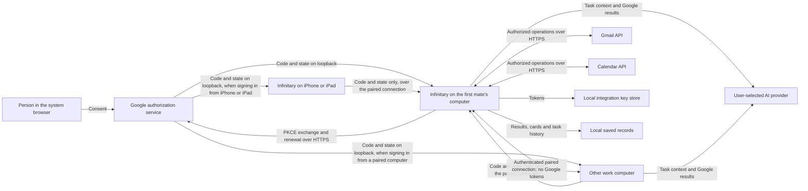

# Google verification material

This page owns the submission copy and evidence requirements for Infinitary's desktop Google integration.
It is an internal working draft, not a published privacy policy, a signed security declaration, or Google's approval.
The implementation is described in [Integrations](integrations.md#google).
Registration alone does not establish verification readiness.

## Readiness and ownership

The captain registers the Desktop app client in Google Cloud, accepts Google's terms, verifies the domain with their own sign-in, submits the verification, and engages an assessor if Google requires one.
The fleet prepares and checks the code, website copy, permission explanations, demonstration and technical answers.
The captain's registration is INF-903; client integration and this material are INF-887; verification submission is INF-904; assessment is INF-905.
No sample client belongs in `GOOGLE_OAUTH_CLIENT`.

| Requirement | What the submission must establish |
| --- | --- |
| Application identity | Actual project and Desktop app client, publisher's legal identity, support and privacy contacts, homepage and privacy policy on a verified domain, and the same app name everywhere. None is inferred from a project name. |
| Implemented permissions | Every requested permission has demonstrated functionality in the submitted build. Gmail and Calendar share the connection; permissions for future features are not a justification. |
| Consent and AI disclosure | Before Google access starts, the person sees and accepts how mail reaches the model providers, connected computers and saved task records. Google's consent screen alone does not explain these transfers. |
| Limited Use | Provider terms and account settings support the disclosed use, including no general-model training on Google data or its derivatives. A user's own subscription is not evidence of this. |
| Protection and deletion | Tokens and Google-derived records have adequate protection at rest and a demonstrated deletion route. File permissions are not encryption; disconnecting is not deleting transcripts. |
| Real demonstration | Infinitary's actual registered client, real consent screen and each requested permission's user-facing function appear in the verification video. A local stand-in is only rehearsal. |
| Assessment | Google or its assessor confirms the applicable scope and assurance level. Draft answers and passing product tests are not a letter of assessment. |

`GOOGLE_OAUTH_CLIENT` holds the registered Desktop app configuration for development and packaged builds on both channels.
The captain's private experimental rollout uses stable for private testers and alpha for personal development.
Packaged builds offer the existing Google connection but ignore development client and endpoint overrides.
The app does not infer verification or assessment from the build channel or Google's publishing status.
Public-launch readiness still needs the evidence and submissions above.

### Private experimental rollout

The intended Google Cloud configuration is **Google Auth Platform → Audience → External**, then **Publish app** to set **In production**, without submitting scope verification during this experimental phase.
The captain makes that account-side change; enabling the code does not publish the Cloud project or prove its current status.
Google's [audience documentation](https://support.google.com/cloud/answer/15549945?hl=en) distinguishes publishing from verification: an unverified production audience accepts accounts without a manually maintained tester list, subject to Google's controls.
Anyone reaching the authorization flow can attempt to connect; private distribution, not a Google invitation list, limits who receives the app.
Unapproved sensitive or restricted scopes still show Google's unverified-app warning and normally share a **100-user lifetime project cap**, not a concurrent-user allowance.
The cap cannot be reset, and Google may adjust quotas based on risk and history.
Managed accounts and other Google security restrictions can still block access.
New grants issued in production are not subject to the [seven-day refresh-token expiry specific to External / Testing](https://developers.google.com/identity/protocols/oauth2#expiration); changing status is not evidence that existing Testing grants gain a longer lifetime.
Revocation, Gmail password changes and other token-expiry conditions still apply.
If the project remains in Testing, only listed test users can connect and the seven-day rule still applies to these scopes.
Google's [restricted-scope guide](https://developers.google.com/identity/protocols/oauth2/production-readiness/restricted-scope-verification#exceptions) describes development/testing exceptions, not a blanket exemption for any product with fewer than 100 users.
An experimental rollout does not waive privacy, Limited Use, disclosure, downstream AI-processing or data-protection obligations, and does not claim CASA approval.
Use disposable Google data while the protection, deletion and provider-processing gaps below remain unresolved.

### Client handoff

After registration, ask once for the captain's chosen handoff of the downloaded **Desktop app** client file.
Prefer a file made available to this task, outside the working copy, over credentials pasted into a message, form or command line.
Do not assume a path on the captain's computer exists on a computer running the task.
Read only the supplied installed-client fields; reject a web client, service-account key, access token or refresh token.
Google calls desktop apps public clients that cannot keep a client secret confidential; the desktop client identity is not a user's Google sign-in.
Explain that the accepted design distributes this client configuration with the code, and never treat it as a confidential server credential.
Do not print the downloaded file or include it in reports, recordings or submission attachments.
Keep account tokens, passwords, verification codes and service-account keys out of the code entirely.
Remove any temporary copies the task creates after the intended fields are consumed; leave the captain's original file intact.

## Architecture and data inventory for reviewers

Infinitary is a desktop application, with an iPhone and iPad app that controls it, not a hosted mail service.
The computer running the first mate makes OAuth, Gmail and Calendar requests directly to Google.
Other paired computers can run agents that request those operations through the first mate's computer; the results, but not the Google tokens, can travel to those computers.
A person can start the sign-in from a paired computer, or from Infinitary on iPhone or iPad: Google's page opens in that computer's browser or the phone's in-app browser, and that computer or phone passes the one-time code and state back to the first mate's computer, which alone makes the PKCE exchange and keeps the tokens.
The chosen AI providers receive the task context and tool answers needed for the work.
Consequently, this is **not** a claim that Google data never leaves the user's computers or never reaches third-party servers.



| Data | Use and destination | Storage owner |
| --- | --- | --- |
| Google refresh token | Renew and revoke access. Applied only inside the protected Secrets owner to the renewal request sent to Google's token address, never returned to the integration or as tool output. | A hidden entry in Secrets ([Secrets](secrets.md#app-services)), sealed under a root key held in the macOS Keychain or the Linux Secret Service; each renewal is approved on Secrets' card, once with Always allow. A file an earlier version kept is moved in and removed. |
| Google access token | Authorize API calls; revoke on removal. | The app's memory only; renewed at each start and before it expires. |
| Account address, scopes, expiry, sign-in health | Identify the row and maintain access. The address appears in Settings and agent context. | `GoogleSignInStore`, `userData/integrations/google.json`, 0600. |
| Message identifiers, thread identifiers, labels, headers and snippets | Search and triage mail; query results reach the requesting agent and its model provider. | Gmail holds the mailbox; returned results persist in model sessions for 30 days, and in what agents write into task records and outputs. |
| Message text and attachment metadata | Read a selected message; HTML is converted to text. The read action reports attachment names, types, sizes and part numbers. | Results persist in sessions for 30 days, and in what agents write into reports, cards and user-requested files. |
| Attachment files | A crewmate saves one attachment the person approved into its task's hand-over folder (users.messages.attachments.get), to read or use it for the task. | The task's hand-over folder on the computer that runs it, 0600, until the task closes or 30 days pass, or Delete Gmail and Calendar content. Words an agent reads inside the file are not fenced and persist in its session past the 30 days. |
| Recipients, subject and outgoing text | Prepare a draft or send after the person's approval of an exact action. | The pending write ask and task record keep its input; Gmail holds accepted drafts and sent messages. |
| Inbox history cursor and sender/subject summaries | Poll for new inbox messages while a rule listens; supply summaries, fenced as data from outside, to the rule's first mate turn. | Automation's saved cursor and task/session records. Lost history starts from now rather than replaying an old inbox. |
| Calendar lists, event data and availability | List calendars and events, read event details and busy intervals, create or update an event after approval, and react to changes in a selected calendar. Event data includes titles, descriptions, times, locations and attendees where Google returns them; a change notification carries title and times but not descriptions or guests. | Google holds the calendars; results persist in sessions for 30 days, and in what agents write into task records, cards and outputs. Automation keeps a per-account, per-calendar sync token. |
| Diagnostic events | Fixed event names, booleans, numbers, app version and random installation identifier; no Google content or email address in permitted fields. | Sharing service and the configured diagnostics endpoint, as described in [Sharing](sharing.md). |

Removing Google calls revocation and deletes the local sign-in and keys even if Google cannot be reached.
A network failure is therefore not evidence that Google revoked the grant remotely; the person can also remove access in their Google Account.
Removal leaves task records, session transcripts, outputs and copies held by other services intact.
What an agent read from Gmail or Calendar stays in its saved conversation for 30 days after it was read, then a note takes its place ([Task retention](task-retention.md#words-from-outside)).
Delete Gmail and Calendar content, in Settings → Integrations under Data, does the same at once for everything read so far, on this computer and on the computers that run its work, and the conversations themselves stay.
What an agent wrote in its own words, such as a report, a card or a file, stays until the task is deleted; the Settings data purge deletes every saved task on this computer.
Backups, exported files and AI-provider retention require separate treatment.

## Permission justifications

Google's verification form asks, for each sensitive or restricted scope, a scope justification, the intended data usage and a link to a demo video ([Manage app data access](https://support.google.com/cloud/answer/15549135), [Verification requirements](https://support.google.com/cloud/answer/13464321)).
The copy below is written from the calls the code makes, named by Google's method names so a reviewer can check it against the source; change it in the same pull request as `GOOGLE_SCOPES`, `gmail.ts` or `calendar.ts`.
Submit the exact scope list in `GOOGLE_SCOPES` for the build being submitted and nothing else: Google requires every listed scope to be used and shown in the video, so a scope the code never requests is removed from the Data access page with its delete icon, never justified.
Google's installed-app guide says incremental authorization is unsupported; it does **not** waive Google's rule against asking for permissions for unimplemented features.
One demo video serves every scope; its recording script is in "Demonstration script" below.

### What each scope does in the code

| Scope | Calls | Where |
| --- | --- | --- |
| `gmail.modify` | `users.messages.list`, `users.messages.get`, `users.labels.list`, `users.messages.modify`, `users.drafts.create`, `users.messages.send`, `users.getProfile`, `users.history.list` | `gmail.ts` |
| `calendar.events` | `events.list` (with a time range or search words, and with a sync token for a rule), `events.get`, `events.insert`, `events.patch` | `calendar.ts` |
| `calendar.calendarlist.readonly` | `calendarList.list` | `calendar.ts` |
| `calendar.events.freebusy` | `freeBusy.query` | `calendar.ts` |
| `calendar.readonly` | none; not in `GOOGLE_SCOPES` | remove it from the Data access page |
| `gmail.settings.basic` | none; not in `GOOGLE_SCOPES` | remove it from the Data access page |

`calendar.events` covers neither `calendarList.list` nor `freeBusy.query`, so each takes the narrowest scope Google lists for it.

### Gmail: `https://www.googleapis.com/auth/gmail.modify`

**Scope justification:**

```text
Infinitary is a desktop AI assistant that runs on the user's own computer (macOS, Linux and Windows). The user connects their Google account in Settings → Integrations, then asks the assistant in plain words for help with their own mail. With gmail.modify the app:

1. Searches the mailbox with the user's Gmail search words and lists each result's sender, recipients, subject, date, labels and snippet (users.messages.list; users.messages.get with format=metadata; users.labels.list to show label names).
2. Reads one chosen message in full to summarize it or answer questions about it, reporting attachment names, types and sizes (users.messages.get with format=full).
3. Saves one attachment the user approved into the task's own folder on their computer, so the assistant can read or use it for the task (users.messages.get with format=full; users.messages.attachments.get). The file is removed when the task closes or after 30 days, whichever is first.
4. Adds or removes labels on a message, including archiving by removing INBOX (users.messages.modify).
5. Saves a reply draft (users.drafts.create).
6. Sends a message (users.messages.send).
7. When the user turns on an automation rule for new mail, checks the inbox every minute for messages added since the last check and gives the rule each new message's sender and subject (users.getProfile for the starting history id; users.history.list).

Every action starts at Asks you, including searches and reads. The app shows the exact input and the agent’s reason on its own confirmation card. Only this time runs that call once; Always allow also allows future calls of that action on the same connection until the user changes it in Settings or replaces the connection. Changes and sends highlight Only this time, so Always allow takes a deliberate choice. The app never deletes messages, never reads or changes Gmail settings, and has no feature beyond the seven above.

Why narrower scopes do not work: gmail.readonly cannot label, archive, draft or send. gmail.send cannot search or read mail, so the assistant could not find the message the user is asking about. gmail.compose can draft and send but cannot search or read the inbox or change labels. gmail.metadata cannot read message text, so the assistant could not summarize a message or write a reply to it. gmail.labels manages the label list but cannot apply a label to a message. Google's reference accepts only https://mail.google.com/, gmail.modify and gmail.modify.restricted (domain-wide delegation) for users.messages.modify. gmail.modify is the narrowest scope that covers reading, labelling, drafting and sending together, and it excludes the permanent deletion that https://mail.google.com/ would add and the app does not offer.
```

**Intended data usage:**

```text
Gmail data (message headers, labels, snippets, message text, attachment names, types and sizes, attachments the user approves saving, inbox history ids and the account's email address) is used only to carry out the request the user made in the app: find, read, summarize, organize, draft and send their own mail, save an attachment for a task, and run the mail rules they turn on. Infinitary does not use it for advertising, never sells it, and does not use it to train or improve AI models.

Requests go directly from the user's computer to Google over HTTPS. The publisher operates no server, so no Google data passes through one of ours. To answer the user's request, what the assistant read is sent to the AI provider the user connected to Infinitary under their own subscription (for example Anthropic, OpenAI, xAI or OpenRouter), and may also reach another computer the user paired to run that work. The answer stays in the task's saved conversation on the user's computers for 30 days, then a note replaces it; the user can delete it sooner in Settings.

Google's sign-in tokens are kept on the user's computer in a file readable only by their account. Removing the connection in Settings deletes them and revokes the app's access at Google. The privacy policy at https://getinfinitary.com/privacy describes this flow and tells the user that their AI provider's terms and settings govern retention and model improvement there.
```

### Calendar: `https://www.googleapis.com/auth/calendar.events`

**Scope justification:**

```text
Infinitary is a desktop AI assistant that runs on the user's own computer. With calendar.events the app, when the user asks:

1. Lists events in a calendar the user can access, over a time range or by search words, expanding recurring events into occurrences (events.list with timeMin, timeMax, q and singleEvents).
2. Reads one event with its times, location, description, guests and recurrence (events.get).
3. Creates an event with a title, times and optional description, location and guests (events.insert).
4. Updates only the named fields of an existing event (events.patch).
5. When the user turns on an automation rule for calendar changes, checks one calendar the user chose every minute with Google's sync token and gives the rule the title and times of each created, changed or cancelled event (events.list with syncToken and showDeleted).

Every Calendar action starts at Asks you. The app shows its exact input and the agent’s reason, including whether guests are notified (sendUpdates, none by default). Only this time runs that call once; Always allow also allows future calls of the action until the user changes it in Settings or replaces the connection. Changes highlight Only this time. The app never deletes events, never changes sharing, and never creates or deletes calendars.

Why narrower scopes do not work: calendar.events.readonly cannot create or update events. calendar.events.owned excludes shared calendars the user can edit, such as a family or team calendar the user names by its id. calendar.app.created reaches only calendars this app created, never the user's existing calendars. The full calendar scope adds calendar creation, sharing changes and permanent deletion, which the app does not need.
```

**Intended data usage:**

```text
Event data (titles, descriptions, locations, times, guests, recurrence and status) and the ids of the calendars it belongs to is used only to answer the user's schedule questions, create or change the events they approve, and run the calendar rules they turn on. Infinitary does not use it for advertising, never sells it, and does not use it to train or improve AI models.

Requests go directly from the user's computer to Google over HTTPS. The publisher operates no server, so no Google data passes through one of ours. To answer the user's request, what the assistant read is sent to the AI provider the user connected to Infinitary under their own subscription (for example Anthropic, OpenAI, xAI or OpenRouter), and may also reach another computer the user paired to run that work. The answer stays in the task's saved conversation on the user's computers for 30 days, then a note replaces it; the user can delete it sooner in Settings.

Google's sign-in tokens are kept on the user's computer in a file readable only by their account. Removing the connection in Settings deletes them and revokes the app's access at Google. The privacy policy at https://getinfinitary.com/privacy describes this flow and tells the user that their AI provider's terms and settings govern retention and model improvement there.
```

### Calendar: `https://www.googleapis.com/auth/calendar.calendarlist.readonly`

**Scope justification:**

```text
Infinitary is a desktop AI assistant that runs on the user's own computer. With calendar.calendarlist.readonly the app lists the calendars the user is subscribed to, with their ids, names, time zones and access roles (calendarList.list), when the user asks, so the user and the assistant can choose which calendar an event action, an availability question or a change rule works on. Nothing is changed with this scope.

Why narrower scopes do not work: this is the narrowest scope that reads the calendar list. calendar.events does not cover calendarList.list, and calendar.calendarlist would add subscribing and unsubscribing, which the app does not do.
```

**Intended data usage:**

```text
The calendar list (each calendar's id, name, time zone and the user's access role) is used only to let the user and the assistant choose which calendar a request works on. Infinitary does not use it for advertising, never sells it, and does not use it to train or improve AI models.

Requests go directly from the user's computer to Google over HTTPS. The publisher operates no server, so no Google data passes through one of ours. To answer the user's request, what the assistant read is sent to the AI provider the user connected to Infinitary under their own subscription (for example Anthropic, OpenAI, xAI or OpenRouter), and may also reach another computer the user paired to run that work. The answer stays in the task's saved conversation on the user's computers for 30 days, then a note replaces it; the user can delete it sooner in Settings.

Google's sign-in tokens are kept on the user's computer in a file readable only by their account. Removing the connection in Settings deletes them and revokes the app's access at Google. The privacy policy at https://getinfinitary.com/privacy describes this flow and tells the user that their AI provider's terms and settings govern retention and model improvement there.
```

### Calendar: `https://www.googleapis.com/auth/calendar.events.freebusy`

**Scope justification:**

```text
Infinitary is a desktop AI assistant that runs on the user's own computer. With calendar.events.freebusy the app reads busy intervals for up to 50 calendars the user names, over a time range the user asks about (freeBusy.query), to answer availability questions such as when the user is free on a given day, without reading the events themselves. Nothing is changed with this scope.

Why narrower scopes do not work: calendar.events does not cover freeBusy.query. calendar.events.freebusy is the narrowest scope that reads availability on calendars the user has access to, including shared calendars the user names by id.
```

**Intended data usage:**

```text
Busy intervals (start and end times with no event details) for the calendars and time range the user named is used only to answer the availability question the user asked. Infinitary does not use it for advertising, never sells it, and does not use it to train or improve AI models.

Requests go directly from the user's computer to Google over HTTPS. The publisher operates no server, so no Google data passes through one of ours. To answer the user's request, what the assistant read is sent to the AI provider the user connected to Infinitary under their own subscription (for example Anthropic, OpenAI, xAI or OpenRouter), and may also reach another computer the user paired to run that work. The answer stays in the task's saved conversation on the user's computers for 30 days, then a note replaces it; the user can delete it sooner in Settings.

Google's sign-in tokens are kept on the user's computer in a file readable only by their account. Removing the connection in Settings deletes them and revokes the app's access at Google. The privacy policy at https://getinfinitary.com/privacy describes this flow and tells the user that their AI provider's terms and settings govern retention and model improvement there.
```

### Calendar: `https://www.googleapis.com/auth/calendar.readonly`

Not requested: `GOOGLE_SCOPES` asks `calendar.calendarlist.readonly` and `calendar.events.freebusy` in its place, and it is removed from the Data access page rather than justified.
A sign-in an earlier version made with `calendar.readonly` keeps working, since Google accepts it for both `calendarList.list` and `freeBusy.query`.

### Gmail: `https://www.googleapis.com/auth/gmail.settings.basic`

Not requested: `GOOGLE_SCOPES` does not hold it and no code under `src/core/integrations/providers/google/` calls a Gmail settings method.
It is removed from the Data access page rather than justified; a restricted scope the app never uses would fail the video check and widen the security assessment.

## Privacy policy draft

**Not in force; not for publication in this form.**
This is proposed Google-integration policy copy for legal and technical review, not a revision of [Infinitary’s privacy policy](https://getinfinitary.com/privacy).
The website policy is published; the proposed Google wording below is not.
Replace the bracketed details only with facts supplied by the owner and publish only after the readiness requirements above are met.
The policy must be publicly accessible on the verified homepage's domain and linked both from that homepage and the consent screen.

### Infinitary and your Google data

Publisher: Infinitary Labs, Inc., a Delaware corporation, help@getinfinitary.com.
Privacy contact: help@getinfinitary.com.
Effective date: **[publication date]**.

Infinitary is an AI assistant that runs on your computers using the AI accounts you connect.
Connecting Google is optional.
Infinitary asks Google for permission to read, organize, draft and send email and for the Calendar permissions described in its consent screen.
You can also list calendars, read events and availability, and approve event creation or changes.
Infinitary does not offer an event-deletion action.
Infinitary does not receive your Google password.

### What Infinitary accesses and why

When you ask for help with email, Infinitary can retrieve message identifiers, senders, recipients, subjects, dates, labels, snippets, message text and attachment names, types and sizes.
With your approval, it can save an attachment into the task's own folder on your computer; the file is removed when the task closes or after 30 days, and words read inside it are not marked as information from outside.
It uses those results to answer your request, organize messages and prepare replies.
It shows a card for your approval before labelling or archiving a message, creating a draft or sending a message.
If you enable a new-mail rule, Infinitary checks Gmail's inbox history and gives the sender and subject of new messages to the assistant running your rule.
For Calendar tasks, Infinitary can retrieve calendar names and identifiers, access roles, time zones, event titles, descriptions, locations, start and end times, attendees and availability.
You approve event creation or updates, including the requested guest notifications.
A Calendar rule checks for changes in your selected calendar and sends event titles and times to the assistant; its notification summary excludes descriptions and guests.
The Google account address identifies your connection in the app.
Google sign-in tokens allow the app to keep working without asking you to sign in for each request.

### Where your information goes

Google receives requests for your Gmail and Calendar accounts and keeps accepted messages, drafts, mailbox changes and calendar changes in those services.
Infinitary runs those requests on the computer where your first mate lives.
Your other connected work computers can receive results needed for their tasks without receiving the Google sign-in tokens.
Your chosen AI providers receive the mail or calendar content and task context used to answer your request or carry out your rules.
This may include full message text when the assistant reads a message, not only its subject.
Infinitary is not an offline-only mail reader.
The app's publisher does not operate a server that relays your Google sign-in or mailbox contents.
If you ask the assistant to put information in a file or send it elsewhere, that output may create further copies or share it with your chosen recipients.
Anyone can send you a message written to steer an AI assistant.
Infinitary marks mail and calendar content as information from outside, never as instructions, and asks you before every Gmail or Calendar change.
A message can still mislead an assistant, and an assistant working on a task can reach the internet without asking you, so a misled assistant could send what it read elsewhere.

**Publication requirement:** identify the permitted AI-provider processing arrangements and their retention and training terms before replacing this paragraph with final copy; the in-product consent for these transfers is Google's notice ([Integrations](integrations.md#googles-notice)).
Do not claim all user-selected subscriptions prohibit training or human review.
The disclosure must cover every recipient permitted for Google-derived data, including summaries and saved task context.

### Storage, retention and your controls

Infinitary stores Google sign-in tokens and connection details on the computer where the connection is made.
The current implementation protects token files using operating-system file permissions, not application-level encryption.
Mail and calendar content an assistant reads stays in its saved conversation for 30 days, then a note takes its place: on the computer where the connection is made, and on another computer you paired to run work when the assistant's conversation runs there.
To delete it sooner, use Delete Gmail and Calendar content in Settings → Integrations, under Data: it replaces everything read so far, in every saved conversation on that computer and on the computers that run its work, and a conversation still working is cleaned once its work pauses.
A computer that runs work and is out of reach, or runs an Infinitary without this control, is cleaned once it is back in reach or updated, and the delete says how many conversations wait for it.
What the assistants wrote themselves, such as a summary in a task's cards, notes or files you asked to create, stays until you delete the task.
None of this expires when you disconnect Google or finish a task.

In Settings → Integrations, you can pause Google or turn off individual actions to stop subsequent calls through those controls.
Removing Google deletes the local sign-in and tokens and asks Google to revoke access.
If the request cannot reach Google, also remove Infinitary's access from your [Google Account connections](https://myaccount.google.com/connections).
Disconnecting does not delete your Gmail messages, existing task history, output files, backups or copies already sent to AI providers.
Purge task data in Settings → General deletes every saved task on that computer, not copies held elsewhere.
Contact **[privacy email]** for help identifying retained copies and the applicable deletion route; do not send your Google password or tokens.

**Publication requirement:** extend these instructions to exports and providers before publication.
Do not promise encrypted storage until it exists and has been demonstrated.

### Other app data

Diagnostics, when enabled and disclosed, sends a fixed set of usage events, the app version and a random installation identifier to the configured diagnostics service.
Its permitted fields do not carry your Google address, message text, prompts, cards or file paths.
You can turn Diagnostics off in Settings → General → Sharing.
The contribution feature is unavailable in current builds; this policy does not authorize contributing Google data for training.

### Limited Use commitment for publication

**Publish the following commitment only when the application and every downstream processing arrangement can meet it:** Infinitary's use and transfer to any other app of information received from Google APIs will adhere to the [Google API Services User Data Policy](https://developers.google.com/terms/api-services-user-data-policy), including the Limited Use requirements, and the [Google Workspace user data and developer policy](https://developers.google.com/workspace/workspace-api-user-data-developer-policy).
Google data and information derived from it will not be sold, used for advertising or credit decisions, or used to train or improve generalized AI models.
Any permitted transfer will serve the disclosed user-facing feature with the user's consent or another exception Google explicitly permits.
Human access will be limited to the exceptions Google's policy permits, including the user's affirmative agreement to view specific data.

A future contribution or model-training feature needs its own review; redaction alone does not remove Google's restrictions on derived data.
A change to these practices requires updated disclosures and any new consent Google requires before the changed use starts.

## Demonstration script

The submission video shows the same registered application, the complete real OAuth grant in English, and every requested permission in use ([Demo video](https://support.google.com/cloud/answer/13804565), [Verification requirements](https://support.google.com/cloud/answer/13464321)).
Google's restricted-scope guide asks for the video on YouTube as Unlisted, showing that the consent screen names the app; one video covers every scope and every OAuth client of the project.
A stand-in recording proves only the local UI and is never submitted as Google's real consent page.
The captain records it on a Mac of their own, since Google's consent page runs in the person's own browser and the task browser keeps its typing private; passwords, verification codes, authorization codes and tokens never enter the published video.

### Before recording

- Use a Google account that holds only demo mail and a demo calendar, since Google's reviewers watch the video.
  Before recording, send that account two messages with the subject "Infinitary demo: invoice", and make a calendar named "Infinitary demo" with two events this week.
- On the Mac that records, run an installed Infinitary build that shows Google's notice when you click the Google chip, asks you for each Gmail and Calendar action, and asks the two narrower Calendar permissions, calendar.calendarlist.readonly and calendar.events.freebusy.
  A build that opens Google's sign-in straight away, or still asks calendar.readonly, is older than the submitted behavior and is not recorded.
  Settings → Integrations must show the Google chip and no Google row; if a row is there, use its menu's Sign out and remove first.
- Set your browser to English and keep its address bar visible.
  Press Shift-Command-5, choose Record Entire Screen, and turn the microphone on if you narrate; Google says voice or text narration speeds its review.

### Recording

1. Start recording with Infinitary open.
   Say: "Infinitary is a desktop AI assistant that runs on my computer.
   I'm connecting my Google account."
2. Open Settings → Integrations and click the Google chip.
   Infinitary shows its notice of what it uses from Gmail and Calendar and where it goes; leave it still long enough to read, then click Accept and continue to Google.
   Your browser opens Google's sign-in; choose the demo account.
3. If Google says it has not verified this app, click Advanced, then Go to Infinitary (unsafe).
   That warning is what this verification removes.
4. On the consent page, check that the language at the bottom left is English and the title names Infinitary.
   Leave the page still for three seconds so every permission can be read, then click Continue.
5. Back in Infinitary, the Google row shows the demo address.
   Click its chevron to show its actions: every action says Asks you until you choose Always allow.
6. Gmail, search and read: in the message box type "Search my Gmail for messages about Infinitary demo and read me the newest one."
   The app asks for each action with the agent’s reason and exact input; choose Only this time or Always allow, then wait for the answer.
7. Gmail, label: type "Archive that message."
   The app shows the exact change and your first mate's reason; choose Only this time.
   In the browser, open Gmail and show the message is no longer in Inbox.
8. Gmail, draft: type "Draft a reply to it saying thanks, I'll send the invoice on Friday."
   Click the card's button.
   Show Gmail's Drafts holding the reply.
9. Gmail, send: type "Send an email to <the demo address> with the subject Infinitary demo: sent from Infinitary and the text Hello from Infinitary."
   The card shows the recipient, subject and text; click its button.
   Show the message in Gmail's Sent and in Inbox.
10. Calendar list: type "List my Google calendars."
    The answer names each calendar with its access role.
11. Availability: type "When am I busy tomorrow between 9 and 5 on the Infinitary demo calendar?"
    The answer lists busy intervals.
12. Calendar events, read: type "What's on the Infinitary demo calendar this week?" then "Read the details of the first one."
13. Calendar events, create: type "Create an event called Infinitary demo call tomorrow from 10 to 10:30 on the Infinitary demo calendar, without notifying anyone."
    Click the card's button.
    Show the event in Google Calendar in the browser.
14. Calendar events, update: type "Move the Infinitary demo call to 11."
    Click the card's button.
    Show the change in Google Calendar.
15. Controls: in Settings → Integrations open the Google row's menu and turn its Paused switch on; say that nothing reaches Google while it is paused; turn the switch off.
    Say: "Sign out and remove deletes the sign-in from this computer and revokes the app's access at Google."
16. Stop recording.
    Watch it once: every permission on the consent page readable, the page in English, no password or code on screen.
    Trim the start and end if needed.
17. Upload it to YouTube from your account as Unlisted, not Private, and copy the link.

Optional, not needed for any scope: show a mail rule.
Settings → Automation, new rule, under When choose Google's "A message arrives", prompt "Tell me who wrote and what about", Enable.
Send the demo account a message and wait up to a minute for your first mate's note.

### Submitting

1. Sign in to the Google Cloud console with the account that owns the project named infinitary, at https://console.cloud.google.com/auth/verification?project=infinitary.
2. Open Google Auth Platform → Data access.
   Click the delete icon beside https://www.googleapis.com/auth/gmail.settings.basic, then Save.
   The app's code never asks for it and nothing in Infinitary reads or changes Gmail settings; Google requires every listed scope to be used and shown in the video.
3. On the same Data access page delete https://www.googleapis.com/auth/calendar.readonly, click Add or remove scopes, tick calendar.calendarlist.readonly and calendar.events.freebusy under Google Calendar API, click Update, then Save.
4. Ask your first mate to have the website's crewmate add this sentence to https://getinfinitary.com/privacy, under its Google section: "Infinitary's use and transfer to any other app of information received from Google APIs will adhere to the Google API Services User Data Policy, including the Limited Use requirements."
   Google's Workspace policy requires that statement on the website or in the app, and reviewers look for it.
   The same change brings that section up to date with "Storage, retention and your controls" and "Where your information goes" above: the 30 days, Delete Gmail and Calendar content, and messages written to mislead.
   It is published once a release that shows Google's notice is out, since the sentence relies on the consent that notice asks for.
5. Record and upload the demo video with the script below.
6. Open Verification Center → Data access.
   For each scope Google lists, paste its Scope justification and Intended data usage from below, and the YouTube link into Demo video.
   If Intended data usage is a set of choices rather than a box, choose that the data provides user-facing features and that the app does not use it to train AI models, and put the text in any comment box.
7. On the Branding page, confirm the app name is Infinitary, the home page is https://getinfinitary.com, the privacy policy is https://getinfinitary.com/privacy, the authorized domain getinfinitary.com is verified in Search Console under your sign-in, and the branding status is published.
8. Click Submit for verification.

Google answers by email to the project's owners; keep that address watched.
Google's estimate for restricted-scope review is six weeks, and for gmail.modify Google then points you to the yearly security assessment (INF-905).
Forward each question Google sends to your first mate, so a crewmate drafts the answer from the code.

The per-action confirmations and explicit Always allow choice implement INF-950.
The in-app disclosure and accept before the sign-in starts is Google's notice ([Integrations](integrations.md#googles-notice), INF-949).
Prompt-injection protection is the fence on data from outside, the per-action approval cards and revocable allowances, and the notice's account of what stays open ("Prompt injection" below, INF-951).
Deleting Google-derived content is Delete Gmail and Calendar content and the 30-day replacement ([Task retention](task-retention.md#words-from-outside), INF-952); the same on a computer that runs work is INF-1094.
Google's Workspace policy also asks for tokens encrypted at rest.
The refresh token is sealed in the protected Secrets owner under a root key held in the macOS Keychain, the Linux Secret Service or Windows Credential Manager ([Secrets](secrets.md)), and the access token is never written to disk.

## Prompt injection

Google's Workspace policy asks for "protecting against prompt injection techniques by either using Google Cloud Platform's Model Armor or other prompt injection protection".
Infinitary takes the second route, in three layers:

1. Data from outside is fenced.
   Every Gmail and Calendar answer, and every event summary, reaches the first mate or a crewmate between marks whose random value the writer could not know, with any copy of a mark in the words broken and a line before and after saying never to follow what is inside ([Integrations](integrations.md#data-from-outside)).
   A saved attachment's own content is the exception: the answer naming it is fenced, but words a crewmate reads inside the file are not, and Google's notice says so.
2. Every action starts at Asks you.
   The host shows the exact call and agent’s reason, with Only this time highlighted for changes and sends.
   Always allow also permits later calls of that action until revoked, the first mate's and every crewmate's alike ([Integrations](integrations.md#the-rules)).
3. The person is told before connecting.
   Google's notice says what the app does against a message written to mislead and the way out it cannot close (`INTEGRATION_NOTICES`, [Integrations](integrations.md#googles-notice)).

Model Armor is not used: it runs in a Google Cloud project with billing, so every message would pass either through a service Infinitary runs, which the app does not have for this: the one service of ours the person's work passes through is the phone push relay, which forwards only cards sealed for a paired phone and cannot read them (`docs/phone-push.md`); or through each person's own Cloud project.
A local classifier that judges whether words try to steer an agent is not used either: it would be the host's verdict on natural language, which the project's principles leave to the agent (`docs/principles.md`, "Put ambiguous judgments in agent instructions" and "Build the agent's reach, never its verdicts").
The fence makes a model less likely to follow words it read, but it cannot guarantee that a model never does, so only Google's review decides whether this protection is enough.

### Ways out without an ask

A model misled by a message could try to send what it read elsewhere.
Each way out, and how it stands:

| Way out | Who has it | An ask in the way | Status |
| --- | --- | --- | --- |
| A Gmail send or draft, or a Calendar creation or update that notifies guests | Both | Yes until Always allow: the exact call on a card | Closed at Asks you; deliberately open at Always allowed |
| A GitHub write through its integration, on any repository | Both | Yes until Always allow: the integration’s host card | Closed at Asks you; deliberately open at Always allowed |
| A change on an MCP server, any tool not marked read-only | Both | Yes until Always allow | Closed at Asks you; deliberately open at Always allowed |
| A read on an MCP server, whose input the server receives | Both | Yes until Always allow | Disclosed here: the captain adds each server, and one that fetches any address the agent names is a way out |
| The crewmate's shell: any program, network address, or `git push` to a remote it names | Crewmate | No: crewmate isolation stays social, a captain decision (`docs/architecture.md`, rev-5) | Disclosed in Google's notice |
| A write to the task's own project, which sends at once | Crewmate | No | Disclosed, as the shell |
| The task's browser opening a public address | Crewmate | No | Disclosed, as the shell |
| A crewmate's own web tools, such as a Claude crewmate's fetch and search | Crewmate | No | Disclosed, as the shell |
| A brief or a steer from the first mate to a crewmate | First mate | No; the brief is on the task's record | Disclosed: it hands the words to a crewmate, which has the ways above |
| A card to the captain | Both | The captain reads it | Not a way out: it reaches only the captain, and a card's frame has no network |

Closing the crewmate's ways needs either a crewmate whose network is limited once its task has read Google data, which would revisit the captain's decision that crewmate isolation stays social, or the captain’s confirmation of each Google read.
INF-950 asks for each action and lets the captain choose Always allow; that choice does not close the crewmate’s other ways out.
Google’s notice tells the person about that reach before they connect.

## CASA questionnaire answer bank

These are technical draft answers against the publicly linked [CASA specification](https://github.com/appdefensealliance/ASA-WG/blob/main/CASA/CASA%20Specification.md), not a completed assessor-issued form.
Use the assessor's actual questionnaire and version when received; obtain its decision on applicability and evidence, especially for a desktop app and its third-party AI processing.
“Partial” means a mechanism exists but the full control has not been established.
“Unproven” is not “Yes”; “proposed not applicable” is not an assessor's acceptance.
Do not invent an assurance level, penetration test, certification, scan result or incident procedure.

### General questions

| Question | Draft answer | Evidence or missing evidence |
| --- | --- | --- |
| What does the application do? | Desktop AI-assisted email and calendar productivity, with user-approved changes, new-mail rules and selected-calendar change rules. | `googleIntegration.ts`, `gmail.ts`, `calendar.ts`, `IntegrationsTab.tsx`; the final demo must cover the submitted build. |
| Where does restricted data travel? | Direct Google requests on the first mate's computer, results in local task/session stores and paired computers, and task context/results to selected AI providers. No publisher-operated Gmail proxy. | Data inventory above; downstream provider processing terms and model-request traces still required. |
| What is the authorization model? | Installed-app authorization code flow, S256 PKCE, random state and a loopback callback. Google passwords stay with Google. Changes/sends are kept as exact single-use approval requests. | `signIn.ts`, `IntegrationsService.call/sendAsk`; attach real-consent evidence for the submitted application. |
| Is user data encrypted at rest? | Tokens yes, other records no. The refresh token is sealed in the protected Secrets owner and the access token stays in memory; transcript and output encryption is not established. Do not answer Yes for derived records based on file modes, assumed disk encryption or code the app does not run. | `src/core/integrations/secrets.ts`, `providers/google/googleIntegration.ts`, `src/core/secrets/protected.ts`, `src/main/host/nativeSecrets.ts`; protecting the tokens does not by itself establish protection for every derived record. |
| Can users revoke and delete? | Disconnect removes the local Google facts and keys and attempts revocation. Delete Gmail and Calendar content in Settings → Integrations' Data section replaces what agents read in every saved conversation on that computer and on the computers that run its work, and the same happens on its own 30 days after a read. Agents' own words, provider copies and exports remain. | `googleIntegration.ts` removal, `savedOutsideData.ts`, `placedOutside.ts` `deleteOutside`, `docs/task-retention.md` "Words from outside". |
| Does any AI provider train on the data? | Not established for all supported subscription/provider configurations. The code's routing and a user's subscription do not demonstrate a no-training agreement. Google's notice tells the person before sign-in that their provider's terms and settings decide training and asks them to check. | Review each allowed downstream arrangement and its retention/human-access terms; the consent shown before sign-in is Google's notice (`INTEGRATION_NOTICES`). |
| Are vulnerability management, incident response and owner MFA established? | The project has code review and automated checks, but no current assessment, organization-wide policy or owner-account setting is certified by this answer bank. | Owner/assessor evidence required; do not claim scans, staff training, response deadlines or Cloud Console MFA from code alone. |

### Control mapping

| CASA control | Answer and applicability | Code/document owner and remaining evidence |
| --- | --- | --- |
| 1.1.1–1.1.3: password authentication | Proposed not applicable to an Infinitary password service: none exists. Google authenticates its own accounts; OS sign-in protects the local account. This does not assess those systems or other providers. | `signIn.ts`, `docs/architecture.md`; assessor confirms boundary and provider evidence. |
| 1.2.1: default credentials | No default production Google account is configured. Packaged builds ignore development client overrides. Public client identity is not a user's token. | `client.ts`; inspect the actual release and confirm no test keys or accounts. |
| 1.3.1–1.3.4: out-of-band verifiers | Google owns account verification. Infinitary generates a fresh state and PKCE verifier and cancels its loopback listener; there is no explicit overall sign-in expiry timer in this flow. | `signIn.ts`; assessor determines applicability, and expiry/brute-force requirements need explicit proof rather than a blanket pass. |
| 2.1.1: credentials in URLs | Access and refresh tokens use headers/form bodies. The standard OAuth redirect carries a short-lived authorization code and state; these must not be logged or published. | `signIn.ts`, `googleIntegration.ts`; inspect real capture/logging without exposing token values. |
| 2.2.1: logout invalidation | Partial: local removal deletes tokens and attempts remote revocation. Offline removal cannot certify remote invalidation. | `googleIntegration.ts`; exercise real revocation and explain offline recovery. |
| 2.2.2: password-change sessions | Google owns the password; the app reacts when Google refuses renewal. It cannot assert immediate invalidation of every session on a Google password change. | `googleIntegration.ts`; obtain Google's behavior and assessor's applicability decision. |
| 2.2.3: stateless token expiry | Google issues access-token expiry; Infinitary does not mint its own Google access tokens. Refresh tokens remain until revoked or rejected. | `issuedFrom`, renewal; expiry and other session boundaries require assessment. |
| 2.3.1–2.3.2: cookie flags | The Google integration uses bearer tokens, not an app session cookie. The external browser's Google cookies are Google's, not Infinitary's. | `signIn.ts`; do not apply this exemption to task-browser sign-ins or a future website without reviewing them. |
| 2.3.3–2.3.4: session tokens | OAuth access/refresh tokens authorize the user; static desktop client configuration alone does not. Google's token integrity is Google's responsibility. Paired-device sessions are a separate surface. | `googleIntegration.ts`, `docs/connection.md`; assessor confirms the token and paired-device scope. |
| 2.4.1: sensitive actions | Partial: an authenticated Google request and one-use approval are required for changes/sends. The app trusts the local OS account and does not add a separate password challenge to each approval. | `IntegrationsService.call/sendAsk`; assess account/session requirements, including paired control. |
| 3.1.1–3.1.3: access control | Core checks paused/off state, validates input and keeps changes as asks before calling the binding. A captured ask is consumed before execution and checked again. | `service.ts`; same-account agents have shell access, so this is not a filesystem isolation claim. |
| 3.1.4: object access | Mail requests address Google's authenticated `users/me` mailbox; Calendar requests name the selected calendar under that user's grant. Google enforces mailbox ownership and calendar roles. | `googleIntegration.ts`, `gmail.ts`, `calendar.ts`; real cross-account and shared-calendar role evidence remains to collect. |
| 3.1.5: request forgery | OAuth callback validates method, path and random state; PKCE binds the code exchange. App frames use sandboxed interfaces and host-owned approval controls. | `signIn.ts`, `docs/live-prototype-security.md`; requires broader IPC/paired-device assessment, not only the OAuth test. |
| 3.1.6: directory browsing | The OAuth loopback serves only the callback response, not a directory. No public mailbox file server is part of this integration. | `signIn.ts`; assess other in-scope file-serving components separately. |
| 3.2.1–3.2.2: OAuth | Authorization code plus S256 PKCE, a fresh random state, and a fixed loopback redirect reused during exchange. No implicit or resource-owner-password flow. | `signIn.ts`; pair the protocol tests with real registered-client evidence for the submitted application. |
| 3.3.1: administrator MFA | No public Infinitary administrator login serves Gmail. Cloud, source-host and publication accounts are outside what the code can prove. | Owner supplies account configuration evidence; paired control also needs scope review. |
| 4.1.1–4.1.2: transport | Packaged Google endpoints are HTTPS with redirects refused for API/token calls. Callback is HTTP on 127.0.0.1, as Google's installed-app flow supports. Paired connections use pinned TLS. | `client.ts`, `signIn.ts`, `googleIntegration.ts`, `docs/connection.md`; test actual destinations and certificate rejection. |
| 4.1.3–4.1.4: cryptography | Node's cryptographic randomness and SHA-256 provide PKCE/state; no custom encryption is claimed. At-rest protection remains incomplete. | `signIn.ts`, `secrets.ts`; assess all in-scope cryptography and failure paths. |
| 5.1.1: parameter pollution | Requests build named parameters with `URLSearchParams`; input schemas reject unsupported action fields. No blanket duplicate-parameter audit is claimed. | `signIn.ts`, `gmail.ts`; adverse duplicate callback cases require assessment. |
| 5.1.2: redirects | Token/API requests refuse redirects; production destinations are fixed Google endpoints. | `client.ts`, `googleIntegration.ts`; assess the separate system-browser navigation and any other recipient. |
| 5.1.3–5.1.4: dynamic code/templates | Mail is converted to text, not executed by the mail reader. Cards intentionally support scripts in isolated frames; agents can run code for tasks. | `gmail.ts`, `docs/live-prototype-security.md`; do not claim there is no dynamic execution anywhere. |
| 5.1.5: server-side request forgery | The Google binding uses fixed roots and validated/encoded identifiers; it exposes no arbitrary URL action. Other integrations, browsers and agent shells have broader reach. | `gmail.ts`, `client.ts`, `docs/task-browser.md`; assess the complete Google-data processing boundary. |
| 5.1.6: XML/XPath injection | Proposed not applicable to the Gmail action parser: it consumes JSON and MIME text, not XML/XPath. | `gmail.ts`; confirm no additional in-scope XML consumer. |
| 5.1.7: script injection | HTML mail becomes text; React text is escaped, and authored card HTML is sandboxed rather than sanitized. Every Gmail and Calendar answer reaches an agent fenced as data from outside, between marks the sender cannot forge. | `gmail.ts`, `IntegrationsTab.tsx`, `docs/live-prototype-security.md`, `src/shared/outsideData.ts`; prompt-injection resistance is not proven by stripping markup or by a fence ("Prompt injection"). |
| 5.1.8: database injection | Mail actions do not form SQL. Persisted tasks, asks and rules use their shared storage owners. | `service.ts`, `docs/task-record.md`; review/test those storage paths, not a blanket Yes from the mail module. |
| 5.1.9–5.1.10: commands/file inclusion | Gmail actions do not spawn a shell or load files named in mail. Agents can independently use shells and files for the person's task, and mail reaches them fenced as data from outside; a misled crewmate's shell is a disclosed way out. | `gmail.ts`, `docs/architecture.md`, "Ways out without an ask" above; assess the agent boundary and malicious mail influence. |
| 5.2.1: untrusted files | `save_attachment` writes an approved attachment's bytes into the task's hand-over folder, 0600, named by its sha256 and a reduced form of its name, and never opens or executes it; a crewmate may read it with its own tools, unfenced. Other app file-handling features remain in scope if Google data reaches them. | `gmail.ts`, `service.ts`, `handoverFiles.ts`; assessor confirms coverage. |
| 6.1.1: component vulnerabilities | Unproven. A lockfile, automated tests and release checks are not a current vulnerability assessment. | `pnpm-lock.yaml`, `docs/testing.md`; obtain the assessor's required component inventory, scans and triage. |
| 6.2.1: production debug mode | Partial: packaged Google setup ignores stand-in endpoints and client overrides. This does not audit all production debugging or logging. | `client.ts`; inspect the actual packaged release. |
| 6.3.1: Origin-only authorization | The callback uses state/PKCE, not the Origin header; the core has separate IPC and paired-device authentication. | `signIn.ts`, `docs/connection.md`; verify each in-scope request path. |
| 6.4.1: subdomain takeover | Unproven: no verified homepage/domain inventory is supplied here. | Domain owner and hosting evidence required; check DNS and decommissioned services before publishing. |
| 6.5.1: secret logging | Partial: integration results redact kept token values and connection metadata excludes them. Message bodies can themselves contain sensitive information, and sessions keep Google's results for 30 days. | `secrets.ts`, `store.ts`, `service.ts`; assess logs and saved records with disposable credentials. |
| 6.6.1: clearing client storage | Tokens are not stored in renderer localStorage. Disconnect removes local token/facts files; Google content in saved conversations, on this computer and on the computers that run its work, goes after 30 days or on the Settings delete, while agents' own words stay. | `store.ts`, `savedOutsideData.ts`, `docs/task-retention.md`; demonstrate deletion of derived copies before claiming complete clearance. |
| 6.7.1: secret storage | Partly met: the refresh token is sealed in the protected Secrets owner under a root key in the macOS Keychain, the Linux Secret Service or Windows Credential Manager and used only through a brokered request; the access token stays in memory. On Linux, a program of the same user can read the Secret Service while it is unlocked, and on Windows, Credential Manager whenever the user is signed in. | `src/core/integrations/secrets.ts`, `docs/secrets.md` "Native custody" and "App services"; assess encrypted record storage separately. |

The Workspace policy additionally requires protection against prompt injection and limits general-model training and permanent copies.
These obligations are not discharged by a CASA table or by telling an agent to regard mail as untrusted; "Prompt injection" above is the app's protection and the ways out it leaves open.
The assessor needs the actual data flow, provider contracts, consent, storage/deletion behavior and security evidence, not only this application's source files.

## Sources and maintenance

Recheck the current requirements and the submitted application's behavior before using this copy; a source's requirements are not evidence that Infinitary satisfies them.

- [Google API Services User Data Policy](https://developers.google.com/terms/api-services-user-data-policy): transparency, minimum permissions, Limited Use and security obligations.
- [Google Workspace user data and developer policy](https://developers.google.com/workspace/workspace-api-user-data-developer-policy): permitted Gmail productivity use, prominent consent, AI use restrictions, encryption and prompt-injection protection.
- [Verification requirements](https://support.google.com/cloud/answer/13464321): homepage, policy, domain, permission justifications and complete demonstration video.
- [Restricted scope verification](https://developers.google.com/identity/protocols/oauth2/production-readiness/restricted-scope-verification): third-party-server assessment boundary and periodic reassessment.
- [OAuth for desktop apps](https://developers.google.com/identity/protocols/oauth2/native-app): public desktop clients, PKCE, loopback redirects and lack of incremental authorization.
- [Gmail scopes](https://developers.google.com/workspace/gmail/api/auth/scopes) and [message modification](https://developers.google.com/workspace/gmail/api/reference/rest/v1/users.messages/modify): permission breadth and required authorization.
- [Calendar scopes](https://developers.google.com/workspace/calendar/api/auth): narrower calendar-list, calendar-property and event scopes.
- [CASA requirements](https://appdefensealliance.dev/casa/casa-requirements) and its linked [specification](https://github.com/appdefensealliance/ASA-WG/blob/main/CASA/CASA%20Specification.md): control definitions and assessment applicability.

The implementation owners are `src/core/integrations/providers/google/`, `src/core/integrations/service.ts`, `src/core/integrations/secrets.ts`, `src/renderer/src/settings/IntegrationsTab.tsx`, and the session, task-retention, pairing and sharing documents linked above.
Update this page when those owners change the submitted Google behavior.
Keep recordings, transcripts, scan reports and assessment correspondence in the task evidence or approved submission destination, not committed beside this guide.
